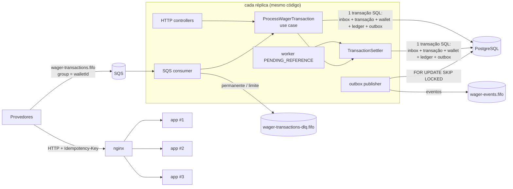

# ARCHITECTURE

Serviço financeiro que processa transações de apostas recebidas por HTTP e SQS. É correto com entregas
duplicadas, fora de ordem e concorrentes, inclusive com várias instâncias rodando ao mesmo tempo.
Este documento registra **o que** foi decidido, **por quê**, o que foi trocado por quê, e **onde está a prova**.

**Sumário**
1. [Visão geral](#1-visão-geral)
2. [Rastreabilidade: requisito → prova](#2-rastreabilidade-requisito--prova)
3. [Decisões centrais](#3-decisões-centrais) (destaque: [B](#b--uma-única-reversão-efetiva-por-referência-mais-restrito-que-o-enunciado); ORM: [I](#i--mikroorm-o-que-é-usado-e-o-que-é-contornado-de-propósito))
4. [Domínio e regras de negócio](#4-domínio-e-regras-de-negócio) (desvios do enunciado: [4.5](#45-desvios-e-interpretações-do-enunciado))
5. [Persistência, concorrência e integridade no schema](#5-persistência-concorrência-e-integridade-no-schema)
6. [Idempotência](#6-idempotência)
7. [Mensageria: consumer, outbox, worker, shutdown](#7-mensageria-consumer-outbox-worker-shutdown)
8. [API HTTP](#8-api-http)
9. [Reconciliação](#9-reconciliação)
10. [Observabilidade](#10-observabilidade)
11. [Autenticação (não implementada; desenho)](#11-autenticação-não-implementada-desenho)
12. [Testes](#12-testes)
13. [Carga](#13-carga)
14. [Stack e ambiente](#14-stack-e-ambiente)
15. [Limitações e próximos passos](#15-limitações-e-próximos-passos)

---

## 1. Visão geral



**Uma submissão (HTTP ou SQS), numa única transação SQL READ COMMITTED:**

1. *(só SQS)* `INSERT inbox ON CONFLICT DO NOTHING`, que deduplica transporte por `(consumer, messageId)`.
2. A wallet existe? A leitura é feita sem lock, e wallets nunca são apagadas.
3. `INSERT wager_transactions (PENDING) ON CONFLICT DO NOTHING`, que deduplica negócio por idempotency key
   e por `(provider, externalId)`. Uma duplicata concorrente espera no índice único. Se não houve insert,
   faz replay do resultado gravado ou responde 409.
4. `SELECT wallet FOR NO KEY UPDATE`: o lock é por wallet, nunca global.
5. `SettlementPolicy.decide(...)` devolve uma decisão: aplicar, sem efeito, rejeitar ou aguardar referência.
6. `UPDATE wallet`, `INSERT ledger` e `UPDATE transação` (estado terminal + snapshot do saldo),
   mais o `INSERT outbox` com os eventos.
7. COMMIT. Os triggers deferred verificam saldo = último lançamento do ledger. Só então vem a resposta HTTP ou o ack SQS.

**Camadas (hexagonal):**
- **`domain/`:** TS puro, sem Nest e sem ORM; ids e relógio vêm de fora.
- **`application/`:** use cases e ports, como classes puras.
- **`infrastructure/`:** MikroORM, SQS, workers e observabilidade.
- **`interfaces/`:** controllers HTTP e consumer SQS.

O Nest só monta os use cases por factory em [app.module.ts](src/app.module.ts).

---

## 2. Rastreabilidade: requisito → prova

Todos os testes usam **Postgres e LocalStack reais**. "e2e" = `bun run test:multi` (3 réplicas atrás do nginx).

### 2.1 Falhas eliminatórias do enunciado

| Eliminatório | Como é impedido | Prova |
|---|---|---|
| `number` para dinheiro | `Money` (decimal.js, string na entrada e na saída), `NUMERIC(19,2)` mapeado como string, `canonicalJson` proíbe `number` | [money.ts](src/domain/shared/money.ts), [money.test.ts](test/unit/domain/money.test.ts), [payload-hash.test.ts](test/unit/application/payload-hash.test.ts) ("rejeita number"), [records.ts](src/infrastructure/persistence/schemas/records.ts) |
| Saldo negativo por race | lock por wallet + `CHECK (balance >= 0)` + `CHECK` do ledger + política de saldo sob lock | [hot-wallet.test.ts](test/concurrency/hot-wallet.test.ts) (100/80/80 ×20; 200 apostas em 150.00), [schema-constraints.test.ts](test/integration/schema-constraints.test.ts) ("CHECK balance >= 0") |
| Débito/crédito duplicado | insert-first com `UNIQUE (provider_id, idempotency_key)` e `UNIQUE (provider_id, external_transaction_id)`, `UNIQUE (transaction_id, wallet_id)` no ledger, inbox, índice de reversão única | [same-operation.test.ts](test/concurrency/same-operation.test.ts) (50× → 1 débito), [crash-after-commit.test.ts](test/concurrency/crash-after-commit.test.ts), [restart-consistency.test.ts](test/recovery/restart-consistency.test.ts), e2e "50x" |
| Idempotência só em memória | só existe no banco: unicidade + snapshot do resultado na própria linha | [use-cases.test.ts](test/integration/use-cases.test.ts) (replay devolve saldo daquele momento), [restart-consistency.test.ts](test/recovery/restart-consistency.test.ts) (replay após restart) |
| Correto só com 1 instância | nenhum estado em memória; locks e unicidade no Postgres; `SKIP LOCKED` nos workers | [same-operation.test.ts](test/concurrency/same-operation.test.ts) (3 pools), e2e (3 réplicas, `X-Instance-Id`), [pending-reference-worker.test.ts](test/integration/pending-reference-worker.test.ts) "duas instâncias", [outbox-publisher.test.ts](test/integration/outbox-publisher.test.ts) "DOIS publishers" |
| Publicar evento antes do commit | eventos só são gravados na outbox, na mesma transação; o publisher só lê linhas confirmadas | [settle-transaction.ts](src/application/wagering/settle-transaction.ts), [outbox-publisher.test.ts](test/integration/outbox-publisher.test.ts) |
| Ledger não auditável | append-only por trigger (UPDATE/DELETE/TRUNCATE) **e por privilégio** (a app só tem SELECT/INSERT no ledger e não é superuser nem dona das tabelas), encadeamento `balance_before = balance_after` anterior, `CHECK` aritmético, versão por lançamento, verificação deferred saldo↔ledger | [004-integrity-triggers.ts](src/infrastructure/persistence/migrations/004-integrity-triggers.ts), [schema-constraints.test.ts](test/integration/schema-constraints.test.ts), [reconciliation.test.ts](test/integration/reconciliation.test.ts), [db-privileges.test.ts](test/integration/db-privileges.test.ts) |
| Testes que mockam Postgres/SQS | nenhum mock de banco ou fila; filas exclusivas por teste; processos reais para crash/restart | [test/](test/), seção [12](#12-testes) |

### 2.2 Requisitos do enunciado

| Requisito (seção do README) | Implementação | Prova |
|---|---|---|
| Money imutável, escala 2, rejeições de entrada (6.1) | [money.ts](src/domain/shared/money.ts) | [money.test.ts](test/unit/domain/money.test.ts), [http-api.test.ts](test/integration/http-api.test.ts) ("25", "25.5", "1e2" → 400) |
| Moeda ISO-4217 com 2 casas na entrada; dado persistido legível (6.1) | [currency.ts](src/domain/shared/currency.ts), `Money.from` × `Money.rehydrate` | [money.test.ts](test/unit/domain/money.test.ts) ("fora da lista ISO-4217", "rehydrate"), [http-api.test.ts](test/integration/http-api.test.ts) (XYZ, JPY → 400) |
| `providerId` `internal` reservado ao OPENING | contrato zod + `WagerTransaction.create` | [http-api.test.ts](test/integration/http-api.test.ts) (400), [sqs-consumer.test.ts](test/integration/sqs-consumer.test.ts) (DLQ), [wager-transaction.test.ts](test/unit/domain/wager-transaction.test.ts) |
| Multi-moeda, conflito de moeda testado (6.1) | `assertSameCurrency`; `CURRENCY_MISMATCH` | [money.test.ts](test/unit/domain/money.test.ts), [wallet.test.ts](test/unit/domain/wallet.test.ts), [settlement-policy.test.ts](test/unit/domain/settlement-policy.test.ts), [use-cases.test.ts](test/integration/use-cases.test.ts) |
| Construtor privado + `create`/`from`/`rehydrate` sem revalidar (6.0) | todas as entidades do domínio | [wager-transaction.test.ts](test/unit/domain/wager-transaction.test.ts) ("rehydrate não revalida") |
| 1 wallet por player+moeda; `version` começa em 1 e só sobe com saldo (6.2) | `UNIQUE (player_id, currency)`; trigger `wallets_guard` | [schema-constraints.test.ts](test/integration/schema-constraints.test.ts), [wallet.test.ts](test/unit/domain/wallet.test.ts), [use-cases.test.ts](test/integration/use-cases.test.ts) (LOSS não muda version) |
| Estados terminais e transições (6.3) | `WagerTransaction` + trigger `wager_transactions_guard` | [wager-transaction.test.ts](test/unit/domain/wager-transaction.test.ts), [schema-constraints.test.ts](test/integration/schema-constraints.test.ts) ("estado terminal é imutável") |
| OPENING interno, na mesma transação SQL (6.3, 9) | `OpenWalletUseCase` | [use-cases.test.ts](test/integration/use-cases.test.ts) (wallet v1 + OPENING + CREDIT + 2 eventos) |
| Ledger imutável estrutural, 1 lançamento por wallet; LOSS e REJECTED sem lançamento (6.4) | `Object.freeze`, `UNIQUE (transaction_id, wallet_id)`, trigger `ledger_matches_transaction` (WL005) | [wallet.test.ts](test/unit/domain/wallet.test.ts) ("imutabilidade estrutural"), [schema-constraints.test.ts](test/integration/schema-constraints.test.ts) |
| Regras BET/WIN/LOSS/REFUND/ROLLBACK (7) | [settlement-policy.ts](src/domain/wagering/settlement-policy.ts) | [settlement-policy.test.ts](test/unit/domain/settlement-policy.test.ts), [use-cases.test.ts](test/integration/use-cases.test.ts) |
| Reversão única; valor igual; mesmo contexto (7.2–7.5) | política + `wt_single_reversal_uq` + FK composta de referência | [settlement-policy.test.ts](test/unit/domain/settlement-policy.test.ts), [hot-wallet.test.ts](test/concurrency/hot-wallet.test.ts) ("REFUND e ROLLBACK da MESMA BET em paralelo") |
| Reversão que estoura saldo, código distinto (7.9) | `REVERSAL_WOULD_OVERDRAW` | [settlement-policy.test.ts](test/unit/domain/settlement-policy.test.ts), [use-cases.test.ts](test/integration/use-cases.test.ts) |
| Crédito além da faixa do saldo é rejeição de negócio, não erro interno | `BALANCE_LIMIT_EXCEEDED` (política) + migration 006 | [settlement-policy.test.ts](test/unit/domain/settlement-policy.test.ts) ("limite superior"), [http-api.test.ts](test/integration/http-api.test.ts) (422), [sqs-consumer.test.ts](test/integration/sqs-consumer.test.ts) (ack, sem DLQ) |
| Replay devolve o resultado original com o saldo do momento (7.7) | snapshot `result_balance` na linha da transação | [use-cases.test.ts](test/integration/use-cases.test.ts), [http-api.test.ts](test/integration/http-api.test.ts) (mesmo status e corpo: 200/422/202), [pending-reference-worker.test.ts](test/integration/pending-reference-worker.test.ts) (202 resolvido → replay com o desfecho atual) |
| Referência fora de ordem, worker, backoff, limite → REJECTED + evento (7.1) | [resolve-pending-references.ts](src/application/wagering/resolve-pending-references.ts) | [pending-reference-worker.test.ts](test/integration/pending-reference-worker.test.ts), [restart-consistency.test.ts](test/recovery/restart-consistency.test.ts) |
| failureCodes estáveis (7.2) | [failure-code.ts](src/domain/wagering/failure-code.ts) | seção [4.4](#44-taxonomia-de-failurecode) |
| Concorrência por wallet; cenário 100/80/80 (8) | `FOR NO KEY UPDATE` (decisão A) | [hot-wallet.test.ts](test/concurrency/hot-wallet.test.ts), [distinct-wallets.test.ts](test/concurrency/distinct-wallets.test.ts) ("wallet A travada não bloqueia B"), [wallet-lock-mode.test.ts](test/integration/wallet-lock-mode.test.ts), e2e |
| ≥ 3 instâncias (8, 13) | compose `replicas: 3` + nginx | e2e [multi-instance.e2e.ts](test/e2e/multi-instance.e2e.ts) |
| Unicidade, imutabilidade e não-negatividade **no schema** (5.9) | migrations 001–009 | [schema-constraints.test.ts](test/integration/schema-constraints.test.ts) (20 testes só com SQL) |
| Garantias valem contra a própria credencial da app (menor privilégio) | migration 008: app sem superuser/ownership, ledger só `SELECT`/`INSERT` | [db-privileges.test.ts](test/integration/db-privileges.test.ts) |
| Migrations versionadas e reversíveis (4) | [migrations/](src/infrastructure/persistence/migrations) | [schema-constraints.test.ts](test/integration/schema-constraints.test.ts) ("são reversíveis") |
| Endpoints e cursor estável e opaco (9) | controllers HTTP, [queries.ts](src/application/queries.ts) | [http-api.test.ts](test/integration/http-api.test.ts) (cursor estável com inserções entre páginas) |
| Status HTTP distintos e consistentes (9) | `HttpErrorFilter` + status pelo resultado | [http-api.test.ts](test/integration/http-api.test.ts), [transient-failures.test.ts](test/integration/transient-failures.test.ts) (503 + Retry-After) |
| Idempotency key, payloadHash canônico, 409 em conflito (9) | seção [6](#6-idempotência) | [payload-hash.test.ts](test/unit/application/payload-hash.test.ts), [use-cases.test.ts](test/integration/use-cases.test.ts), [same-operation.test.ts](test/concurrency/same-operation.test.ts) |
| Reconciliação: loga, mede e sinaliza sem corrigir (9) | [reconcile-wallet.ts](src/application/wallets/reconcile-wallet.ts) | [reconciliation.test.ts](test/integration/reconciliation.test.ts) (divergência forçada com `session_replication_role = replica`) |
| Health live/ready abertos; ready = Postgres + SQS, 503 com o detalhe por dependência (9, 12) | [health.controller.ts](src/interfaces/http/health.controller.ts) | [observability.test.ts](test/integration/observability.test.ts) (fila apagada → `{"sqs":"down"}`), [http-api.test.ts](test/integration/http-api.test.ts) |
| Consumer: mesmo use case, inbox, ack após commit, negócio/transitório/permanente, limite → DLQ, SIGTERM, redelivery (10) | [wager-transaction.consumer.ts](src/interfaces/sqs/wager-transaction.consumer.ts) | [sqs-consumer.test.ts](test/integration/sqs-consumer.test.ts), [crash-after-commit.test.ts](test/concurrency/crash-after-commit.test.ts), e2e (SIGTERM) |
| Queda do Postgres: réplicas voltam a ready sozinhas, sem 5xx depois (3, 13) | pool com timeouts, watchdog de query, ROLLBACK no-op em cliente quebrado, readiness com timeout (§5.4) | e2e "queda do Postgres (30 s) com carga" em [multi-instance.e2e.ts](test/e2e/multi-instance.e2e.ts) |
| Instrução travada não segura a mensagem nem o grupo FIFO (10) | `statement_timeout` por transação (> 2 × `lock_timeout`) + teto do heartbeat | [transient-failures.test.ts](test/integration/transient-failures.test.ts) ("statement_timeout"), [sqs-consumer.test.ts](test/integration/sqs-consumer.test.ts) ("teto do heartbeat"), [consumer-timing.test.ts](test/unit/infrastructure/consumer-timing.test.ts) |
| Atomicidade inbox + transação + wallet + ledger + outbox (6.5, 11) | um único `uow.run` por submissão | [atomicity.test.ts](test/integration/atomicity.test.ts): falha injetada DEPOIS de todas as escritas (HTTP e SQS) → nada persiste |
| Outbox: publishers concorrentes; cenário de 5 passos com processos reais (11) | [outbox-publisher.ts](src/infrastructure/workers/outbox-publisher.ts) | [outbox-crash.test.ts](test/recovery/outbox-crash.test.ts): processo morto com SIGKILL antes de publicar (segurando as linhas) e depois do SendMessage; OUTRO processo publica; cada evento chega uma vez · [outbox-publisher.test.ts](test/integration/outbox-publisher.test.ts) (2 publishers) · [restart-consistency.test.ts](test/recovery/restart-consistency.test.ts) |
| Eventos: classe abstrata + subclasses; `data` com MoneyProps; BalanceChanged só se o saldo mudou (11) | [wagering-events.ts](src/domain/events/wagering-events.ts) | [messaging.test.ts](test/unit/domain/messaging.test.ts), [use-cases.test.ts](test/integration/use-cases.test.ts) (LOSS sem BalanceChanged) |
| Logs JSON com ids, sem payload financeiro (12) | pino + AsyncLocalStorage | [observability.test.ts](test/integration/observability.test.ts) |
| Log de erro dos workers sem inundar durante indisponibilidade (12) | backoff no [polling-worker.ts](src/infrastructure/workers/polling-worker.ts) | [polling-worker.test.ts](test/unit/infrastructure/polling-worker.test.ts) |
| Métricas mínimas; latência em todos os desfechos; duplicata contada uma vez (12) | [metrics.ts](src/infrastructure/observability/metrics.ts) | [observability.test.ts](test/integration/observability.test.ts) ("latência medida em TODOS os desfechos"), [sqs-consumer.test.ts](test/integration/sqs-consumer.test.ts) (redelivery = 1 duplicata), [transient-failures.test.ts](test/integration/transient-failures.test.ts) |
| Concorrência 1–8 (13) | — | 1: [same-operation](test/concurrency/same-operation.test.ts) · 2: [hot-wallet](test/concurrency/hot-wallet.test.ts) · 3: [distinct-wallets](test/concurrency/distinct-wallets.test.ts) · 4: e2e · 5: [crash-after-commit](test/concurrency/crash-after-commit.test.ts) · 6: [outbox-publisher](test/integration/outbox-publisher.test.ts) · 7: [pending-reference-worker](test/integration/pending-reference-worker.test.ts) · 8: [restart-consistency](test/recovery/restart-consistency.test.ts) |
| Invariante final `balance == ledger` em todos | `assertLedgerInvariant()` em `afterEach` em **todas** as suítes com banco | [invariants.ts](test/support/invariants.ts): wallets registradas pelo teste corrente (`touch`: integração, concorrência, recuperação, observabilidade, e2e); nos testes de SQL puro e de privilégios, toda wallet criada/alterada desde o início do teste. Exceção deliberada: as wallets corrompidas de propósito na reconciliação |
| Teste de carga (diferencial) | `bun run test:load` | [load-test-report.md](docs/load-test-report.md), [load-test-analysis.md](docs/load-test-analysis.md) |

---

## 3. Decisões centrais

### ⚠️ B — Uma única reversão efetiva por referência (mais restrito que o enunciado)

O enunciado exige que "uma referência não pode ser revertida duas vezes **pelo mesmo tipo de operação**".
Aplicada ao pé da letra, essa regra permite:

```
BET 100        → saldo -100
REFUND(BET)    → saldo +100   (1ª reversão, kind REFUND)
ROLLBACK(BET)  → saldo +100   (2ª reversão, kind ROLLBACK)  ← crédito duplicado
```

Crédito duplicado é falha eliminatória. Por isso o schema impõe **no máximo uma reversão `PROCESSED`
por referência, de qualquer kind**:

```sql
CREATE UNIQUE INDEX wt_single_reversal_uq ON wager_transactions (reference_transaction_id)
  WHERE status = 'PROCESSED' AND kind IN ('REFUND','ROLLBACK');
```

- Cobre a regra do enunciado: dois REFUND da mesma BET continuam impossíveis.
- `ROLLBACK(REFUND)` continua permitido, porque referencia o REFUND e não a BET.
- A segunda tentativa é rejeitada com `REFERENCE_ALREADY_REVERSED`. Rejeitadas não entram no índice
  parcial, então várias tentativas recusadas ficam auditáveis.
- **Provas:**
  - [schema-constraints.test.ts](test/integration/schema-constraints.test.ts): "índice parcial..."
  - [hot-wallet.test.ts](test/concurrency/hot-wallet.test.ts): 4 reversões concorrentes da mesma BET
    em 10 rodadas, exatamente 1 vence.

### A — Lock da wallet com `FOR NO KEY UPDATE`

**O problema.** O fluxo é insert-first: o `INSERT` em `wager_transactions` valida a FK `wallet_id` e,
para isso, o Postgres pega `FOR KEY SHARE` na wallet. `FOR UPDATE` conflita com `FOR KEY SHARE`,
então dois escritores na mesma wallet entram num ciclo de espera:

1. A e B inserem cada um a sua transação; os dois seguram KEY SHARE na wallet.
2. A pede FOR UPDATE e espera B.
3. B pede FOR UPDATE e espera A. O Postgres detecta o deadlock e aborta uma delas com `40P01`.

**A solução.** `FOR NO KEY UPDATE` serializa os escritores entre si (é o mesmo lock que o próprio
`UPDATE balance` pega, já que nenhuma coluna de chave muda) e não conflita com KEY SHARE.

**Prova:** [wallet-lock-mode.test.ts](test/integration/wallet-lock-mode.test.ts) reproduz os dois casos
no Postgres real.

**Implementação:**
- Como o `LockMode` do MikroORM só gera `FOR UPDATE`, esse lock é SQL explícito no repositório.
- `LockMode.PESSIMISTIC_PARTIAL_WRITE` (`FOR UPDATE SKIP LOCKED`) é usado na outbox e no worker de referências.

### C — `INSERT ... ON CONFLICT DO NOTHING` no insert-first

No Postgres, um erro dentro da transação a aborta, então capturar `unique_violation` exigiria savepoint.
`ON CONFLICT DO NOTHING` mantém a mesma semântica: uma duplicata concorrente **espera** no índice único
até a original confirmar ou desfazer. Se a original desfizer, a duplicata assume. A seção [6](#6-idempotência)
mostra a tabela de desfechos.

### D — `WALLET_NOT_FOUND` não é persistido

A FK `wager_transactions.wallet_id → wallets`: escolhi integridade referencial em vez de permitir transações órfãs.
- **HTTP:** responde 422 `WALLET_NOT_FOUND`.
- **SQS:** é erro de negócio, com **ack e sem inbox**. A exceção desfaz a transação, mas não há efeito
  financeiro a proteger: uma redelivery só recalcula o mesmo resultado, e se a wallet tiver sido criada
  nesse meio-tempo, processa corretamente.

### E — Códigos além do enunciado

- `PLAYER_MISMATCH`, `REFERENCE_NOT_PROCESSED`, `WALLET_NOT_FOUND`;
- `PROCESSING_FAILED`, o único código do estado FAILED.

### F — Eventos em `wager-events.fifo`

`MessageGroupId = aggregateId` e `MessageDeduplicationId = eventId`. O README não define o destino dos eventos.

### G — Outbox nunca descarta

O backoff exponencial tem teto de 5 min, e o evento **nunca** é descartado: perder evento confirmado é
eliminatório. O atraso fica visível em `wagering_outbox_lag_seconds`.

O limite de tentativas vale para PENDING_REFERENCE (seção [7.4](#74-worker-de-pending_reference)).

### H — Itens menores
- **Validação:** zod `strict` (seção [8](#8-api-http)).
- **Balanceamento:** nginx na frente das 3 réplicas.
- **Ledger:** paginado em ordem decrescente de `wallet_version`.
- **Testes:** usam ids próprios, sem `TRUNCATE`, que o ledger bloqueia.


### I — MikroORM: o que é usado e o que é contornado de propósito

**A escolha.** O enunciado (§4) aceita MikroORM (preferencial) ou TypeORM. Fiquei com o MikroORM pelo que ele deixa
**explícito**: cada unidade de trabalho é um `EntityManager` próprio (`fork`), a transação tem fronteira clara
(`em.transactional()`) com nível de isolamento declarado, e o lock é parte da consulta (`LockMode`). O TypeORM resolve o
mesmo com `QueryRunner`, mas o escopo do gerenciador e o cache de entidades ficam menos visíveis no código.

**O que é usado, e para quê:**

| Recurso | Onde | Por quê |
|---|---|---|
| **Unit of Work = `em.fork()` por tentativa** | [mikro-orm-unit-of-work.ts](src/infrastructure/persistence/mikro-orm-unit-of-work.ts) | cada tentativa da transação (e cada retry por `40P01`/`55P03`) nasce num EntityManager limpo: nenhum estado de uma tentativa abortada vaza para a seguinte. A porta `UnitOfWork` da aplicação é essa classe; os use cases não conhecem o ORM |
| **`em.transactional()`** com `IsolationLevel.READ_COMMITTED` | idem; [outbox-publisher.ts](src/infrastructure/workers/outbox-publisher.ts) | delimita a transação SQL única de inbox + transação + wallet + ledger + outbox (§6.5, §11), com `SET LOCAL` de `lock_timeout`/`statement_timeout` no início. A serialização vem do lock, não do isolamento (§5.3) |
| **`LockMode.PESSIMISTIC_PARTIAL_WRITE`** (`FOR UPDATE SKIP LOCKED`) | outbox publisher, worker de PENDING_REFERENCE ([repositories.ts](src/infrastructure/persistence/repositories.ts)) | N instâncias dividem o trabalho sem coordenação: cada uma reivindica linhas diferentes e nenhuma espera a outra |
| **`defineEntity` + mapeadores** | [schemas/records.ts](src/infrastructure/persistence/schemas/records.ts), [mappers.ts](src/infrastructure/persistence/mappers.ts) | os registros de persistência ficam fora do domínio (§6.1: o domínio não depende do ORM nem de decorators). O domínio é reidratado por `rehydrate` |
| **`p.decimal('string')`** | records.ts | `NUMERIC(19,2)` chega e sai como string; o valor nunca passa por `number` entre o banco e o `Money` |
| **Migrator** com `migrationsList` explícita, `transactional` e `allOrNothing` | [mikro-orm.config.ts](src/infrastructure/persistence/mikro-orm.config.ts) | migrations versionadas e reversíveis; ordem determinística, a mesma no host e na imagem |
| **Exceções convertidas** (`UniqueConstraintViolationException`, `DriverException`) | [pg-errors.ts](src/infrastructure/persistence/pg-errors.ts) | classificação por SQLSTATE/constraint, preservada pelo MikroORM nas exceções |

**O que é contornado de propósito, e por quê:**
- **Identity Map nas leituras** (`disableIdentityMap: true`): a wallet é lida **depois** do lock (`FOR NO KEY UPDATE`). Uma
  entidade em cache seria o saldo de antes da espera, exatamente o lost update que o lock evita. Com o fork por tentativa,
  o identity map também não traria ganho entre tentativas.
- **`flush` e o change set automático nas escritas** (`em.insert`/`nativeUpdate` em vez de `persist` + `flush`):
  1. **a ordem é parte das invariantes**: a transação vai para PROCESSED **antes** do lançamento (o trigger WL005 confere
     o status), a wallet antes do lançamento (encadeamento WL002 e o deferred WL004). O `flush` ordena pelo grafo de
     dependências das entidades, não por essas regras;
  2. **insert-first com `INSERT ... ON CONFLICT DO NOTHING`** (decisão C) e **`FOR NO KEY UPDATE`** (decisão A) não são
     expressáveis pelo change set nem pelo `LockMode` (que só gera `FOR UPDATE`);
  3. **o domínio não é entidade do ORM**: as transições ficam encapsuladas nas classes de domínio, e o repositório grava só
     as colunas mutáveis (`mutableTxFields`), as mesmas que o GRANT da app permite atualizar (migration 008).
- **Custo da escolha:** sem cálculo automático de change set nem agrupamento de inserts pelo ORM. Em troca, cada comando SQL
  de uma transação financeira está escrito, em ordem, no caso de uso ou no repositório, sem query escondida.

---

## 4. Domínio e regras de negócio

### 4.1 Money
- **Implementação:** `decimal.js` num construtor **isolado** (`Decimal.clone`, precisão 40), sem alterar
  a configuração global da lib. Com 19 dígitos, `add`/`subtract` são sempre exatos.
- **Escala fixa no contrato**, como diz o README: `amount` tem **exatamente 2 casas** (`"25.00"`).
  `"25"` e `"25.5"` são rejeitados com 400. Mais de 2 casas também é **rejeitado, nunca arredondado**,
  porque arredondar dinheiro em silêncio esconde erro do provedor.
- **Também rejeitados:** sinal, notação científica, `NaN`/`Infinity`, vazio, zero à esquerda, espaços,
  vírgula, valor que não seja string e valor acima da faixa de NUMERIC(19,2).
- **Negativos:** só por aritmética interna (`negate`/`subtract`, por exemplo a diferença da reconciliação),
  nunca pela entrada.
- **Moeda:** na entrada (`Money.from`), só códigos ISO-4217 de moedas correntes com unidade menor de **2 casas**
  ([currency.ts](src/domain/shared/currency.ts)), coerente com a escala fixa. JPY/KRW (0 casas) e KWD/BHD (3 casas)
  são recusadas: 2 casas fixas criariam centavos inexistentes ou perderiam milésimos. Fundos, metais, códigos de
  teste e moedas retiradas também ficam fora. A reidratação do banco (`Money.rehydrate`) confere só o formato, para
  que um dado gravado continue legível se a lista mudar (ex.: uma moeda retirada da ISO).
- **Persistência:** o Postgres devolve `numeric` como **string**, mapeado com `p.decimal('string')`.
  Em nenhum ponto o valor passa por `number`. Somas de reconciliação são feitas em NUMERIC e devolvidas como texto.
- **Banco:** `NUMERIC(19,2)` + `currency CHAR(3)`. O FK composto `(wallet_id, currency)` garante que o
  lançamento está na moeda da wallet.

### 4.2 Regras e interpretações
**Ordem de verificação** na [SettlementPolicy](src/domain/wagering/settlement-policy.ts):
1. player e moeda da wallet;
2. contexto da referência;
3. kind da referência;
4. status da referência;
5. valor e reversão anterior;
6. saldo: insuficiente num débito, ou acima da faixa de NUMERIC(19,2) num crédito (`BALANCE_LIMIT_EXCEEDED`).

O que invalida a operação para sempre é verificado antes do que depende de estado. A política é uma
função pura que **decide** e não executa: aplicar, sem efeito, rejeitar ou aguardar.

| Kind | Efeito | Ledger | Observação |
|---|---|---|---|
| BET | débito | DEBIT | sem saldo → `INSUFFICIENT_FUNDS` |
| WIN | crédito | CREDIT | referência opcional à BET da rodada, com qualquer valor |
| LOSS | nenhum | nenhum | valor ≥ 0; não muda `version`; só `WagerTransactionProcessed` |
| REFUND | crédito | CREDIT | só referencia BET PROCESSED; valor igual; uma vez |
| ROLLBACK | inverso da referência | invertido | BET → crédito; WIN/REFUND → débito; estouro de saldo → `REVERSAL_WOULD_OVERDRAW` |
| OPENING | crédito | CREDIT | interno; criado com a wallet; não pode ser submetido |

- **⚠️ Extensão: LOSS com referência.** O README não prevê referência em LOSS. Ela é aceita
  opcionalmente, com as mesmas checagens do WIN (contexto e kind BET), em vez de ser ignorada.
- **⚠️ WIN rejeitado por referência ausente.** Um WIN **com** referência cuja BET nunca chega fica em
  PENDING_REFERENCE durante a janela do worker (10 tentativas, cerca de 2 min). Depois vira
  `REJECTED`/`REFERENCE_NOT_FOUND`, **sem crédito**, e emite o evento.
  - A referência declarada é tratada como pré-condição. É o comportamento conservador:
    não credita prêmio de aposta que não existe.
  - Contrapartida: um prêmio legítimo com referência errada fica retido; o provedor reenvia com novo
    `externalTransactionId`.
  - LOSS segue a mesma regra, sem efeito financeiro.
- **Referência em outro contexto.** Referência de outra wallet, player ou rodada é rejeitada com
  `REFERENCE_MISMATCH` **sem gravar** `reference_transaction_id`, porque a FK composta só aceita
  referência da mesma wallet.
- **⚠️ Referência de outro provider.** A referência é resolvida por `(providerId, referenceExternalTransactionId)`,
  como diz o enunciado (§7.2). Por isso uma transação que cite o `externalTransactionId` de **outro** provedor não
  encontra referência alguma: fica `PENDING_REFERENCE` (202) durante a janela do worker e termina
  `REJECTED`/`REFERENCE_NOT_FOUND`, e não `REFERENCE_MISMATCH`. É intencional: o id externo só tem significado
  dentro do provedor que o emitiu, e um provedor não pode nem sondar a existência das transações de outro.
  Prova: [http-api.test.ts](test/integration/http-api.test.ts) ("referência de OUTRO provider").
- **Referência existente, mas PENDING_REFERENCE** (ex.: ROLLBACK de um REFUND que ainda espera a BET):
  a transação também aguarda. As cadeias se resolvem em ordem causal.
- **Snapshot do resultado** (`result_balance`, `result_wallet_version`): gravado em toda transação
  PROCESSED e REJECTED. É o que o replay devolve, inclusive para LOSS e REJECTED, que não têm ledger.

### 4.3 Estados
```
PENDING ──► PROCESSED | REJECTED | FAILED
   └─────► PENDING_REFERENCE ──► PENDING_REFERENCE (nova tentativa) ──► PROCESSED | REJECTED | FAILED
```
PENDING só existe dentro da transação SQL. Os estados terminais são congelados no domínio
(`InvalidTransactionStateError`) **e** no banco (trigger `WT001`).

### 4.4 Taxonomia de failureCode
| Código | Ação do provedor | Quando |
|---|---|---|
| `INSUFFICIENT_FUNDS` | retry_later (nova transação) | BET maior que o saldo |
| `REVERSAL_WOULD_OVERDRAW` | give_up (operacional) | ROLLBACK que debitaria (de WIN/REFUND) deixaria saldo negativo |
| `BALANCE_LIMIT_EXCEEDED` | give_up (operacional) | crédito (WIN, REFUND, ROLLBACK de BET) que levaria o saldo além de NUMERIC(19,2) |
| `REFERENCE_NOT_FOUND` | fix_payload | referência não chegou dentro da janela |
| `REFERENCE_MISMATCH` | fix_payload | referência de outro player/wallet/moeda/rodada |
| `REFERENCE_ALREADY_REVERSED` | give_up | já existe reversão efetiva (decisão B) |
| `REFERENCE_NOT_PROCESSED` | give_up | referência REJECTED/FAILED |
| `AMOUNT_MISMATCH` | fix_payload | valor da reversão ≠ valor da referência |
| `CURRENCY_MISMATCH` | fix_payload | moeda da operação ≠ moeda da wallet |
| `INVALID_REFERENCE_KIND` | fix_payload | REFUND→BET; ROLLBACK→BET/WIN/REFUND; WIN/LOSS→BET |
| `PLAYER_MISMATCH` | fix_payload | wallet não pertence ao player |
| `WALLET_NOT_FOUND` | fix_payload | walletId inexistente (não persistido) |
| `PROCESSING_FAILED` | retry_later (nova transação) | status FAILED |

Toda rejeição é terminal **para aquela Idempotency-Key**: reenviar com a mesma key devolve o mesmo
resultado. "retry_later" significa enviar uma *nova* transação.

---

### 4.5 Desvios e interpretações do enunciado
O §7 exige documentar toda interpretação adicional. Esta é a lista completa; cada item tem a justificativa
na seção indicada e uma prova.

| # | Enunciado | O que o serviço faz | Por quê | Onde / prova |
|---|---|---|---|---|
| 1 | Referência não revertida duas vezes "pelo mesmo tipo de operação" | **uma** reversão PROCESSED por referência, de **qualquer** kind | REFUND + ROLLBACK da mesma BET creditaria duas vezes (eliminatório) | decisão [B](#b--uma-única-reversão-efetiva-por-referência-mais-restrito-que-o-enunciado); [hot-wallet.test.ts](test/concurrency/hot-wallet.test.ts) |
| 2 | LOSS sem referência prevista | LOSS aceita referência opcional, com as checagens do WIN | não descartar em silêncio um campo enviado | §4.2; [settlement-policy.test.ts](test/unit/domain/settlement-policy.test.ts) |
| 3 | WIN "pode referenciar" a BET | WIN/LOSS **com** referência ausente aguardam e viram `REFERENCE_NOT_FOUND` | não creditar prêmio de aposta inexistente | §4.2; [pending-reference-worker.test.ts](test/integration/pending-reference-worker.test.ts) |
| 4 | — | LOSS aceita `0.00`; os demais kinds exigem > 0 | LOSS só registra o resultado | §4.2; [wager-transaction.test.ts](test/unit/domain/wager-transaction.test.ts) |
| 5 | A key é a fonte da verdade | mesmo `(provider, externalId)` com outra key → 409 `EXTERNAL_TRANSACTION_ID_CONFLICT` | a mesma operação do provedor não pode ter dois efeitos | §6; [use-cases.test.ts](test/integration/use-cases.test.ts) |
| 6 | Escopo da key não definido | unicidade e replay por `(providerId, key)` | keys de provedores diferentes podem coincidir | §6; [http-api.test.ts](test/integration/http-api.test.ts) |
| 7 | — | `WALLET_NOT_FOUND` não é persistido (422; ack sem inbox no SQS) | integridade referencial (FK) | decisão D; [use-cases.test.ts](test/integration/use-cases.test.ts) |
| 8 | Taxonomia livre | códigos extras: `PLAYER_MISMATCH`, `REFERENCE_NOT_PROCESSED`, `WALLET_NOT_FOUND`, `PROCESSING_FAILED`, `BALANCE_LIMIT_EXCEEDED` | situações distintas para o provedor | §4.4 |
| 9 | Escala fixa de 2 casas | mais de 2 casas é **rejeitado**, nunca arredondado | arredondar dinheiro esconde erro do provedor | §4.1; [money.test.ts](test/unit/domain/money.test.ts) |
| 10 | Moeda ISO-4217 | na entrada, só moedas ISO-4217 correntes com unidade menor de **2 casas** (JPY, KRW, KWD, BHD, fundos, metais e códigos retirados → 400 `INVALID_MONEY`); dado já persistido é reidratado validando só o formato | a escala fixa de 2 casas não representa JPY (0) nem KWD (3); a lista pode mudar sem tornar dados ilegíveis | §4.1; [currency.ts](src/domain/shared/currency.ts); [money.test.ts](test/unit/domain/money.test.ts); [http-api.test.ts](test/integration/http-api.test.ts) |
| 11 | — | crédito que estouraria NUMERIC(19,2) → REJECTED `BALANCE_LIMIT_EXCEEDED` | é regra de negócio, não erro interno | §4.2; [http-api.test.ts](test/integration/http-api.test.ts) |
| 12 | Referência do mesmo provider (§7.2) | referência de **outro** provider não é encontrada → `REFERENCE_NOT_FOUND` após a janela | id externo só vale dentro do provedor; não vaza existência | §4.2; [http-api.test.ts](test/integration/http-api.test.ts) |
| 13 | Replay devolve o resultado original | resultado terminal: mesmo status e corpo; **202 resolvido** devolve o desfecho atual | o estado mudou e o provedor precisa saber | §8; [pending-reference-worker.test.ts](test/integration/pending-reference-worker.test.ts) |
| 14 | FAILED é erro permanente de infraestrutura | gravado só pelo consumer (limite de recebimentos) e pelo worker (linha venenosa); HTTP responde 503; replay de FAILED → 422 `PROCESSING_FAILED`; sem evento | FAILED é terminal e não pode nascer de erro transitório | §7.1–7.2; [sqs-consumer.test.ts](test/integration/sqs-consumer.test.ts) |
| 15 | — | `providerId` `internal` reservado (400 / DLQ) | namespace das transações internas (OPENING) | §8; [http-api.test.ts](test/integration/http-api.test.ts) |
| 16 | Destino dos eventos não definido | `wager-events.fifo`, grupo = aggregateId, dedup = eventId | ordem por agregado e dedup no broker | decisão F |
| 17 | UUIDs (playerId, walletId, parâmetros de rota) | normalizados para **minúsculas** na entrada (HTTP e fila), antes do payloadHash e da política | o RFC 9562 trata hex como case-insensitive; sem isso, a mesma BET em maiúsculas era rejeitada com `PLAYER_MISMATCH` (reauditoria, M2) | §8; [http-api.test.ts](test/integration/http-api.test.ts), [sqs-consumer.test.ts](test/integration/sqs-consumer.test.ts) |

---

## 5. Persistência, concorrência e integridade no schema

### 5.1 Garantias no schema
Migrations em [migrations/](src/infrastructure/persistence/migrations), todas com `down`.
Cada uma das garantias abaixo tem teste só com SQL em [schema-constraints.test.ts](test/integration/schema-constraints.test.ts).

| Garantia | Mecanismo |
|---|---|
| Saldo nunca negativo | `CHECK (balance >= 0)`; `CHECK` de saldos não negativos no ledger |
| Uma wallet por player+moeda | `UNIQUE (player_id, currency)` |
| Idempotência | `UNIQUE (provider_id, idempotency_key)` (migration 007), `UNIQUE (provider_id, external_transaction_id)` |
| No máximo um lançamento por transação | `UNIQUE (transaction_id, wallet_id)` no ledger |
| Lançamento coerente com a transação: só de transação `PROCESSED`, nunca de LOSS, mesmo valor e moeda, direção do kind (ROLLBACK = inverso da referência) | trigger `ledger_matches_transaction` (`WL005`, migration 009) |
| Aritmética do lançamento | `CHECK (balance_before ± amount = balance_after)` |
| Ledger append-only | trigger bloqueia UPDATE, DELETE e TRUNCATE (`WL001`) |
| Ledger encadeado | trigger: `balance_before` = `balance_after` anterior; `UNIQUE (wallet_id, wallet_version)` |
| Lançamento na moeda da wallet | FK `(wallet_id, currency) → wallets(id, currency)` |
| Saldo = último lançamento (no COMMIT) | constraint trigger `DEFERRABLE INITIALLY DEFERRED` (`WL004`) |
| `version` começa em 1 e sobe +1 só com o saldo | trigger `wallets_guard` (`WL003`) |
| Wallet e transação nunca apagadas | triggers + ausência de DELETE nos GRANTs da app |
| Estado terminal e campos de negócio imutáveis | trigger `wager_transactions_guard` (`WT001`) |
| Referência na mesma wallet | FK `(reference_transaction_id, wallet_id) → wager_transactions(id, wallet_id)` |
| Reversão única por referência | índice único parcial (decisão B) |
| Um OPENING por wallet | índice único parcial |
| Dedup da inbox | `PRIMARY KEY (consumer_name, message_id)` |
| Coerência de campos | `CHECK`s: referência exigida em REFUND/ROLLBACK e proibida em BET/OPENING; `failure_code` ⇔ REJECTED/FAILED; snapshot ⇔ PROCESSED/REJECTED |

### 5.2 Privilégios: owner × aplicação (migration 008)
Os triggers protegem contra bug; não protegem contra quem tem as credenciais do dono das tabelas, que
pode desligá-los (`ALTER TABLE ... DISABLE TRIGGER`, `SET session_replication_role = replica`).
Por isso há duas identidades:

| Identidade | Variável | Uso | Privilégios |
|---|---|---|---|
| **owner** do schema | `MIGRATION_DATABASE_URL` | migrations; testes que contornam as garantias de propósito (divergência forçada na reconciliação, SQL puro do schema) | dono das tabelas (no compose de dev é o usuário de bootstrap, superuser) |
| **aplicação** | `DATABASE_URL` | réplicas, consumer, workers, testes de comportamento | membro de `wagering_app_rw`: sem superuser, sem ownership, sem CREATE |

`wagering_app_rw` (NOLOGIN, criado pela migration 008):
- **ledger:** só `SELECT` e `INSERT`. Append-only também por privilégio.
- **wallets, wager_transactions, inbox, outbox:** `SELECT`, `INSERT` e `UPDATE` **só das colunas mutáveis**
  (saldo/versão; status, snapshot e agendamento; processamento da inbox; publicação da outbox). Identidade e
  campos de negócio ficam fora do alcance da app, além dos triggers.
- Nenhum `DELETE`, `TRUNCATE`, `TRIGGER` ou `REFERENCES`.

O **login** da app (nome e senha de `DATABASE_URL`) é provisionado pelo [migrate.ts](src/infrastructure/persistence/migrate.ts)
depois das migrations e herda o papel; a senha é configuração operacional e não fica em migration versionada.
O migrate recusa um `DATABASE_URL` igual ao owner. Em produção o owner também não seria superuser
(bastaria `CREATEROLE` para a 008); aqui ele é superuser só porque é o usuário de bootstrap da imagem do Postgres.
O papel é do cluster: o down da 008 revoga os privilégios no database e só remove o papel se nenhum outro database
ainda o usar. Tabela nova numa migration futura precisa de `GRANT` explícito.

**Prova:** [db-privileges.test.ts](test/integration/db-privileges.test.ts), com a conexão da app:
`UPDATE`/`DELETE`/`TRUNCATE`/`DISABLE TRIGGER` no ledger e `SET session_replication_role` → `42501`.

### 5.3 Transação e locks
- **Isolamento:** READ COMMITTED + `FOR NO KEY UPDATE` por wallet. A serialização vem do lock,
  não do isolamento. Com SERIALIZABLE, todo conflito em hot wallet viraria abort (`40001`) e retry caro,
  em vez de uma espera curta.
- **Escritas:** nativas (`em.insert`/`nativeUpdate`) em vez de `flush`. A ordem dos comandos importa
  (FKs e trigger de encadeamento) e fica explícita. `em.transactional` delimita a transação.
  As leituras usam `disableIdentityMap`. Justificativa completa na decisão [I](#i--mikroorm-o-que-é-usado-e-o-que-é-contornado-de-propósito).
- **Retry da unit of work:** repete a transação inteira para `40001`, `40P01`, `55P03` e para violação de
  `wt_single_reversal_uq` (uma corrida perdida; na nova tentativa a regra devolve `REFERENCE_ALREADY_REVERSED`).
  - Até 5 tentativas, com backoff de 10–200 ms e jitter, cada uma num `fork` novo do EntityManager.
  - **Cada retry** incrementa `wagering_db_lock_conflicts_total{sqlstate}` e gera log `warn`.
  - Esgotadas as tentativas: **503 com `Retry-After: 1`**.
- **`lock_timeout` por transação** (`SET LOCAL`, 5 s): sem teto, uma hot wallet empilharia conexões
  esperando indefinidamente. Com ele, a espera vira `55P03`, depois retry e, se persistir, 503:
  degradação explícita e mensurável. Prova: [transient-failures.test.ts](test/integration/transient-failures.test.ts).
- **Classificação de erros** ([pg-errors.ts](src/infrastructure/persistence/pg-errors.ts)), percorrendo o erro e as causas
  encadeadas (`cause`/`previous` do MikroORM):
  - SQLSTATE manda: `40001`/`40P01`/`55P03` e `wt_single_reversal_uq` são **retryable**; classe `08`, `57P01`–`57P03`,
    `53300` e `57014` são **unavailable**; qualquer outro SQLSTATE é erro do servidor com significado próprio (**other**).
  - **Sem SQLSTATE** (o `pg` só manda SQLSTATE em erros do servidor): erro do driver (`DriverException`/`ConnectionException`)
    ou mensagem de transporte conhecida ("not queryable", "Connection terminated", timeout de aquisição do pool, watchdog
    de query, `ECONNREFUSED`...) é **unavailable**. Na v1.0.0, "Client has encountered a connection error and is not
    queryable" caía em **other** e virava **HTTP 500** (reauditoria, achado M3).
  - **unavailable** vira `TransientInfrastructureError` na unit of work: **503 + Retry-After** no HTTP, **retry** no consumer.
  - O worker de PENDING_REFERENCE **nunca** marca FAILED por erro transitório: além da conversão da unit of work, ele
    confere `isTransientDbError` de novo antes de gravar FAILED. Só erro de programação/dado (linha venenosa) vira FAILED.
  - **Prova:** [connection-failures.test.ts](test/integration/connection-failures.test.ts), com a conexão REAL derrubada por
    `pg_terminate_backend`: (a) no meio da espera do lock (57P01) e (b) **entre** duas instruções, o que produz o
    "not queryable" sem SQLSTATE. Para HTTP (503, nunca 500; o reenvio debita uma vez), consumer (retry, sem DLQ nem
    FAILED) e worker (a linha continua PENDING_REFERENCE e é resolvida depois). Por mutação: com o classificador antigo,
    o HTTP responde 500 e o teste do worker falha. Matriz de classificação em
    [pg-errors.test.ts](test/unit/infrastructure/pg-errors.test.ts).
- **Ids:** UUIDv7 (`Bun.randomUUIDv7`): ordenáveis por tempo e sem coordenação entre instâncias.

### 5.4 Queda do Postgres: o pool se recupera sozinho
**O problema (reauditoria da v1.0.0, achado A1).** Com o Postgres parado por 30 s sob carga, réplicas ficavam
travadas **para sempre** depois que ele voltava: readiness sem resposta, consumer e workers parados, liveness verde
(ninguém reiniciava). Reproduzido isoladamente, a causa tem duas partes:
1. **Vazamento de conexão no Kysely** (usado pelo MikroORM 7): `ControlledTransaction.rollback()` só devolve a conexão
   ao pool **depois** de um ROLLBACK bem-sucedido, e um BEGIN que falha também não a devolve. Num cliente cuja conexão
   caiu, o ROLLBACK falha ("Client has encountered a connection error and is not queryable"), e cada falha vazava
   uma vaga. Com 10 vazamentos (o pool inteiro), a réplica não conseguia mais nenhuma conexão.
2. **Nada limitava a espera no cliente:** sem `connectionTimeoutMillis`, quem pedia uma vaga esperava para sempre;
   uma query enviada logo antes de o servidor sumir esperava a resposta para sempre (o `statement_timeout` é do
   servidor).

**A correção** ([pg-pool-resilience.ts](src/infrastructure/persistence/pg-pool-resilience.ts), aplicada em
`buildOrmConfig` para a app, os testes e as ferramentas):
- **ROLLBACK/BEGIN em cliente quebrado viram no-op bem-sucedido.** O servidor já desfez a transação quando a conexão
  caiu; o Kysely então devolve o cliente, e o `pg-pool` o descarta porque ele não é "queryable". **COMMIT nunca é
  simulado.**
- **Dois tetos distintos**, porque o `pg-pool` usa a mesma opção (`connectionTimeoutMillis`) para os dois:
  - abrir conexão (`DB_CONNECT_TIMEOUT_MS`, 5 s): servidor fora vira erro rápido, 503 / retry SQS. Imposto na classe de
    cliente que o pool instancia;
  - esperar vaga no pool (`DB_POOL_ACQUIRE_TIMEOUT_MS`, 30 s): numa hot wallet, a fila do pool é espera legítima. A 1ª
    versão usava 5 s para os dois e o hot-wallet de 200 apostas recebeu 503 na espera por vaga. Nunca é infinito.
- **Watchdog de query** (`DB_QUERY_TIMEOUT_MS`, padrão `statement_timeout` + 3 s = 18 s): query sem resposta além
  disso **destrói a conexão**, então ela rejeita com erro de conexão (transitório) e o pool descarta o cliente. O
  `query_timeout` nativo do `pg` não serve: ele rejeita a query mas mantém o cliente preso e o pool o reaproveita.
  Fica acima do `statement_timeout` para que uma instrução só lenta termine pelo servidor (`57014`).
- **Isenção do lock da wallet**, a mesma do `statement_timeout` (§7.3): a instrução marcada com `LOCK_WAIT_MARKER` não
  tem watchdog, porque a fila de uma hot wallet é espera legítima no servidor vivo. Servidor morto embaixo dela é
  detectado pelo **keepalive de TCP** (`keepAlive` no pool; no compose, `sysctls` de 5 s × 3 sondas, em vez de
  75 s × 9 do Linux).
- **Handler de `'error'`** em clientes ociosos e emprestados: a conexão que cai é registrada (`database connection
  error; client discarded`) e descartada; sem listener, o evento derrubaria o processo.
- **Readiness com timeout de 1 s** na checagem do Postgres: com o banco fora (ou o pool esgotado), responde **503**
  com `{"postgres":"down"}` em vez de travar.
- **`application_name`** por réplica (`wagering-app:<instância>`): aparece em `pg_stat_activity` e é usado pelo guard
  dos testes do host.

**Prova:** e2e "queda do Postgres (30 s) com carga" em [multi-instance.e2e.ts](test/e2e/multi-instance.e2e.ts): o
Postgres é parado com `docker compose stop -t 0` durante a carga e religado. As 3 réplicas voltam a ready **sem
reinício** (mesmo `StartedAt`) em até 60 s depois de ele ficar healthy; depois disso, 60 requisições nas 3 réplicas
dão 200 (nenhum 5xx); mensagens SQS novas são processadas; o que a carga recebeu sem resposta definitiva é reenviado
com a mesma key; cada BET PROCESSED debitou uma vez e a invariante bate.

---

## 6. Idempotência

- **Fonte da verdade:** o header `Idempotency-Key` (HTTP) ou `data.idempotencyKey` (SQS), gravado em
  `UNIQUE (provider_id, idempotency_key)`. Nada fica em memória.
- **Escopo por provedor:** a key é escolhida pelo provedor, e dois provedores podem gerar a mesma
  (contadores, ids de rodada). Com unicidade global, a operação legítima de um seria bloqueada com 409
  pela do outro. Por isso a unicidade e o lookup do replay são por `(providerId, key)` (migration 007).
  Prova: [http-api.test.ts](test/integration/http-api.test.ts) ("escopo por provedor") e
  [schema-constraints.test.ts](test/integration/schema-constraints.test.ts).
- **payloadHash:** `hex(SHA-256(UTF-8(canonicalJson({ v: "wager-payload/v1", ...campos de negócio }))))`.
  - Campos de negócio: providerId, externalTransactionId, playerId, walletId, roundId, gameId, kind,
    money, referenceExternalTransactionId.
  - Ficam fora: a key, messageId, occurredAt e correlationId.
  - JSON canônico: chaves ordenadas recursivamente, `undefined` omitido e `number` proibido.
  - A versão do algoritmo entra no conteúdo hasheado, para poder evoluir.

| Situação após `ON CONFLICT DO NOTHING` | Resposta |
|---|---|
| mesmo provedor, mesma key, mesmo hash | replay do resultado gravado (status e corpo originais, `idempotentReplay: true`) |
| mesmo provedor, mesma key, hash diferente | 409 `IDEMPOTENCY_KEY_PAYLOAD_MISMATCH` |
| mesmo `(provider, externalId)`, outra key | 409 `EXTERNAL_TRANSACTION_ID_CONFLICT` |

**No SQS, duas camadas:**
- **inbox** (transporte): mesmo messageId → nenhum efeito novo. Mesmo messageId com conteúdo
  diferente → `INBOX_PAYLOAD_MISMATCH` → DLQ.
- **idempotency key** (negócio): o provedor reenviou a mesma operação com outro messageId.

---

## 7. Mensageria: consumer, outbox, worker, shutdown

### 7.1 Consumer SQS ([wager-transaction.consumer.ts](src/interfaces/sqs/wager-transaction.consumer.ts))
- **Mesmo use case do HTTP:** `executeFromMessage` = mesmo `process()` + inbox na **mesma transação SQL**.
- **Envelope tolerante, `data` estrito:**
  - no envelope só `data` é obrigatório; campos extras passam (uma mudança de envelope do produtor
    não pode mandar dinheiro para a DLQ);
  - sem `messageId`, usa o `MessageId` do SQS;
  - `data` é zod `strict`, com `idempotencyKey`.
- **Ack só depois do commit.** Um crash entre o commit e o ack causa redelivery, que a inbox reconhece:
  nenhum efeito novo. Provado com processo real morto com `exit 137` no hook pós-commit.
- **Ordem por wallet: best-effort; o banco é a autoridade** (enunciado §8: "recursos de ordenação e deduplicação do
  broker são otimização, não a garantia final").
  - Dentro de um lote do `ReceiveMessage`, as mensagens do mesmo `MessageGroupId` (walletId) são processadas **em
    sequência**; grupos diferentes, em paralelo.
  - **Se uma mensagem do grupo não termina** (retry, ou DLQ que falhou), as seguintes do mesmo grupo **não são
    processadas**: voltam à fila com visibilidade maior que o atraso do retry (`held_behind`), para que a que falhou
    seja entregue antes delas. Na v1.0.0 o consumer seguia processando o grupo: com a BET1 (90,00) em retry, a BET2
    (20,00) era aplicada antes e a BET1 terminava `INSUFFICIENT_FUNDS` (reauditoria, M1).
  - **Por que best-effort:** no SQS FIFO, o grupo fica bloqueado enquanto uma mensagem dele está em voo, e isso preserva
    a ordem entre entregas. O LocalStack 4.14 **não** bloqueia: depois de m1 ir para retry (visibilidade 3 s) e m2 voltar
    com visibilidade 0, o `ReceiveMessage` seguinte devolve m2 com m1 ainda em voo (verificado). O atraso maior cobre
    esse caso numa janela de retry, não em retries sucessivos da mesma mensagem, nem entre réplicas que recebem lotes
    diferentes. Garantir ordem estrita exigiria número de sequência por wallet no banco, fora do escopo.
  - **O que não depende da ordem:** nenhuma invariante. Saldo, unicidade, reversão única e referência fora de ordem são
    decididos no banco, sob o lock da wallet (§5); a ordem só muda **qual** de duas apostas concorrentes vence quando o
    saldo não cobre as duas, como já acontece com duas requisições HTTP simultâneas.
  - **Prova:** "ordem FIFO do grupo" em [sqs-consumer.test.ts](test/integration/sqs-consumer.test.ts): BET1 em retry por
    lock, o lock é solto no instante do retry; BET1 PROCESSED, BET2 REJECTED, saldo 10,00. Sem o bloqueio, o teste falha.

| Erro | Ação | FAILED? |
|---|---|---|
| REJECTED (negócio), `WALLET_NOT_FOUND` | ack | — |
| JSON/envelope/`data` inválido, `INVALID_MONEY`, conflito de idempotência, `INBOX_PAYLOAD_MISMATCH` | DLQ (motivo em atributo) | não: não há transação válida e única |
| transitório **ou não classificado**, `receiveCount < 5` | `ChangeMessageVisibility` com backoff (1 s → 60 s) | — |
| transitório ou não classificado **no 5º recebimento** | FAILED (transação separada) e depois DLQ (`retries_exhausted` / `unexpected_error`) | sim |

- **Erro não classificado também passa por retry:** FAILED é terminal, então não pode nascer de um erro
  desconhecido na 1ª tentativa. Ele pode ser uma falha de infraestrutura não mapeada que passa sozinha.
  Prova: "falha inesperada na 1ª tentativa NÃO gera FAILED" em [sqs-consumer.test.ts](test/integration/sqs-consumer.test.ts).
- **Limite vs. redrive:** o consumer desiste no 5º recebimento, e o redrive do SQS (`maxReceiveCount=5`)
  só moveria no 6º. O redrive é a rede de segurança para crash loop.
- **DLQ:** recebe o corpo original, o mesmo grupo, dedup pelo id SQS original e os atributos
  `failureReason`, `receiveCount` e `originalMessageId`. Só depois a mensagem é apagada da origem.

### 7.2 FAILED
- **Quem grava:**
  - o consumer, no limite de recebimentos;
  - o worker de referências, quando uma linha lança erro não transitório. Sem isso, uma "linha
    venenosa" seria reivindicada em loop.
- **Como:** numa **transação separada, curta e best-effort**. O HTTP nunca grava FAILED: ele responde 503.
- **Não trava a wallet** (só o KEY SHARE da FK), então funciona mesmo quando a causa é a wallet disputada.
  Não sobrescreve transação existente.
- **Sem evento de integração:** FAILED não está na lista do enunciado. O sinal é a DLQ e
  `wagering_dlq_messages_total{reason}`.
- **Replay:** devolve 422 `PROCESSING_FAILED`.

### 7.3 Visibilidade: heartbeat + validação no startup
- **Heartbeat:** enquanto uma mensagem é processada, o consumer renova a visibilidade a cada 1/3 do
  timeout. Se o processo morrer, o heartbeat morre junto e a mensagem volta normalmente.
  Prova por **mutação**: desligando o heartbeat, o teste "outro consumer NÃO recebe a mensagem" falha
  (a mensagem foi recebida 2×).
- **Validação no startup** ([config.ts](src/infrastructure/config.ts)): a instância **não sobe** se
  `visibilityTimeout < 1,5 × pior caso`.
  - **`statement_timeout` por transação** (`SET LOCAL`, padrão 15 s): proteção contra instrução **travada** (query
    lenta, rede meio-aberta), não mecanismo de contenção. Precisa ser maior que **2 × `lock_timeout`** (a instância
    não sobe se não for), porque uma instrução pode esperar mais de um lock. Uma instrução travada termina em `57014`,
    tratada como indisponibilidade (503 / retry SQS) e **não** refeita na mesma entrega. Vale também para o publisher
    da outbox.
  - **Exceção: o lock da wallet** ([repositories.ts](src/infrastructure/persistence/repositories.ts), `lockById`). Sob
    contenção contínua, um único `SELECT ... FOR NO KEY UPDATE` espera várias vezes em sequência: cada commit à frente
    reabre a espera pela nova versão da linha. Cada espera respeita `lock_timeout`, mas a soma cresce com a fila, e
    nenhum teto fixo convive com ela: a 1ª versão (8 s) e depois 15 s cortaram em `57014` esperas legítimas do
    hot-wallet de 200 apostas, inclusive na validação a partir de clone limpo. Por isso essa instrução roda com
    `statement_timeout = 0` e é regida só por `lock_timeout` a cada espera (`55P03`, refeita), como antes; o teto
    volta logo depois dela. O que segura uma mensagem é limitado pelo **teto do heartbeat**, não pela fila.
  - Pior caso = o maior de dois caminhos, mais o backoff entre tentativas:
    - lock: (tentativas + 1 da gravação do FAILED) × `lock_timeout`;
    - instrução travada ou sem resposta: (tentativas − 1) × `lock_timeout` + watchdog de query (`DB_QUERY_TIMEOUT_MS`,
      §5.4, maior que o `statement_timeout`) + `statement_timeout` (a gravação do FAILED).
  - Com os defaults: max(6 × 5 s, 4 × 5 s + 18 s + 15 s) + 150 ms = 53,15 s, o que exige ≥ 80 s. Por isso o padrão é **90 s**.
  - **Fora da conta:** a espera por uma vaga no pool da própria réplica (até `DB_CONNECT_TIMEOUT_MS` por tentativa,
    só quando a réplica está saturada) e a soma das esperas do lock isento da wallet. As duas são limitadas pelo teto
    do heartbeat abaixo; uma entrega que passe dele volta à fila e é deduplicada pela inbox.
  - **Teto do heartbeat:** uma mensagem presa volta à fila **no máximo em max(visibility, 1,5 × pior caso)** depois do
    início do processamento: com os defaults, max(90 s, 79,7 s) = **90 s**. O heartbeat calcula esse prazo absoluto no
    início e cada renovação pede só o que falta até ele. A nova entrega é deduplicada pela inbox.
    - **Correção (reauditoria):** a v1.0.0 renovava o visibility inteiro a cada 1/3 dele, `ceil(teto/intervalo)` vezes. A
      última renovação, em t = 90 s, empurrava a volta para **~180 s**, e não os "cerca de 75 s" que este documento dizia.
    - **Prova:** "teto do heartbeat: prazo absoluto" em [sqs-consumer.test.ts](test/integration/sqs-consumer.test.ts)
      (visibility 2 s, teto 5 s: a mensagem reaparece entre 3,5 s e 6,2 s; com o heartbeat antigo, 7,6 s), "teto do
      heartbeat" (outro consumer recebe e a inbox evita o 2º efeito) e "statement_timeout" em
      [transient-failures.test.ts](test/integration/transient-failures.test.ts).
- **Provisionamento convergente:** `CreateQueue` só com os atributos imutáveis da FIFO, depois
  `SetQueueAttributes` com visibilidade e redrive. Mudar a configuração ajusta filas já existentes.

### 7.4 Worker de PENDING_REFERENCE
- **Claim:** reivindica **uma** linha vencida por transação (`FOR UPDATE SKIP LOCKED`), trava a wallet
  e aplica o **mesmo** `TransactionSettler` da submissão. N instâncias dividem o trabalho sem coordenação.
- **Janela:** 10 tentativas (a 1ª é o processamento inicial), base 500 ms ×2, teto 30 s, jitter de 20%: cerca de
  **2 min**. Nominal 0,5 + 1 + 2 + 4 + 8 + 16 + 30 + 30 + 30 = 121,5 s; com o jitter, entre ~97 s e 121,5 s
  (medido na auditoria: 109,5 s até `REJECTED`/`REFERENCE_NOT_FOUND`).
  Fora de ordem em provedores é questão de segundos; minutos cobrem atraso de fila sem prender a
  transação indefinidamente. Ao esgotar: `REJECTED`/`REFERENCE_NOT_FOUND` + `WagerTransactionRejected`.
- **Evento:** `WagerTransactionPendingReference` só na **entrada**; reagendamentos não repetem.
- **Falhas:** erro transitório (conexão, disponibilidade, concorrência) deixa a linha pendente para o próximo ciclo e
  **nunca** a torna FAILED (§5.3); só erro não transitório (bug, dado inesperado) a torna FAILED.

### 7.5 Outbox publisher
- **Reivindicação:** `em.find(..., { lockMode: LockMode.PESSIMISTIC_PARTIAL_WRITE })`, que gera
  `FOR UPDATE SKIP LOCKED`. Lotes de 100: com 10, o publisher não acompanhou cerca de 470 eventos/s
  (lag de 19 s no teste de carga; com 100, 0,84 s).
- **Trade-off: a transação fica aberta durante o publish.** `SendMessageBatch` e a marcação
  `published_at` acontecem na mesma transação.
  - Custo: uma conexão e os locks ficam presos durante I/O de rede.
  - Um crash entre o send e o commit gera republicação. É aceitável: at-least-once por contrato,
    dedup por `eventId` no consumidor e pela FIFO (janela de 5 min).
  - Alternativa: lease (`claimed_until`) com duas transações curtas.
- **Ordem:** entre publishers concorrentes, a ordem por agregado **não** é garantida. Os consumidores usam
  `walletVersion` para ordenar e `eventId` para deduplicar.

### 7.6 SIGTERM
1. O Nest chama `beforeApplicationShutdown` **antes** de o ORM fechar o pool.
2. O consumer para de pedir mensagens. O long poll em andamento **não é abortado**: termina sozinho em até
   `SQS_WAIT_TIME_SECONDS`. Abortar a requisição HTTP não cancela o `ReceiveMessage` no servidor: se o SQS já
   tinha entregado mensagens a ela, essas mensagens ficavam invisíveis até o visibility timeout expirar (até 90 s),
   sem ninguém processando. Foi a causa provável de uma execução do e2e de 104 s.
3. Toda mensagem recebida que não começou, inclusive as que esse último poll trouxer, volta **na hora** para a
   fila (`ChangeMessageVisibility` = 0) e é logada (`message released on shutdown`). Outra réplica a pega em segundos.
4. O que já está em processamento termina dentro de `SHUTDOWN_GRACE_MS`; o que passar do prazo volta pela
   expiração da visibilidade (nada se perde: inbox e key deduplicam).
5. Os workers param no fim do tick, nunca no meio de uma transação.

**Prazos (compose):**

| Prazo | Valor | Regra |
|---|---|---|
| long poll (`SQS_WAIT_TIME_SECONDS`) | 5 s | — |
| pior caso de processamento | 53,15 s | §7.3 |
| `SHUTDOWN_GRACE_MS` | **60 s** | ≥ long poll + pior caso = 5 + 53,15 = 58,15 s. **A instância não sobe** se for menor; sem a variável, o padrão é exatamente esse mínimo |
| `stop_grace_period` | **75 s** | > `SHUTDOWN_GRACE_MS` + 15 s para os workers terminarem o tick corrente (cada instrução limitada pelo `statement_timeout` de 15 s) e o Nest fechar o pool, antes do SIGKILL |

No compose também: `init: true` (tini como PID 1, porque o Nest re-emite o sinal após o shutdown).

**Provas:**
- [sqs-consumer.test.ts](test/integration/sqs-consumer.test.ts): "SIGTERM durante um long poll" (determinístico: o
  único consumer recebe o stop com o poll aberto; as mensagens que chegam a ele são devolvidas e outro consumer as
  processa em menos de 5 s, contra 30 s de visibility no teste) e "stop() conclui a mensagem em andamento";
- [consumer-timing.test.ts](test/unit/infrastructure/consumer-timing.test.ts): o cálculo do prazo de shutdown;
- e2e "SIGTERM durante o long poll": SIGTERM numa réplica ociosa e 30 mensagens logo em seguida; todas processadas
  em menos de 20 s (mensagem presa levaria 90 s), com a contagem do que a vítima devolveu. O envio e a medição rodam
  **dentro da rede do compose**, por outra réplica ([in-network-sender.ts](test/e2e/in-network-sender.ts) via `docker exec`):
  numa execução da reauditoria, o proxy de portas do Docker Desktop segurou um `SendMessage` do host por 30 s e o teste
  mediu o ambiente, não a aplicação. `bun run test:multi`
  5 vezes seguidas (15/10/2026, v1.0.0, quando o e2e tinha 7 testes), todas com 7 pass:

  | Execução | `bun test` | total (com build e subida) | 30 mensagens processadas em | devolvidas pela vítima |
  |---|---|---|---|---|
  | 1 | 23,4 s | 42 s | 383 ms | 3 |
  | 2 | 23,3 s | 42 s | 358 ms | 3 |
  | 3 | 25,3 s | 44 s | 598 ms | 1 |
  | 4 | 23,5 s | 42 s | 828 ms | 2 |
  | 5 | 23,3 s | 42 s | 580 ms | 3 |

  Em todas a vítima recebeu mensagens no long poll que estava aberto no SIGTERM (o cenário foi de fato exercitado)
  e outra réplica as processou em menos de 1 s. O tempo do `bun test` subiu de cerca de 11 s para cerca de 23 s
  porque os dois testes de SIGTERM agora esperam a vítima sair e voltar healthy;
- e2e: `docker kill --signal SIGTERM` numa réplica durante 120 mensagens. Resultado: shutdown cooperativo
  nos logs, saída 143, nada perdido ou duplicado, e a réplica volta healthy após `docker start`.
  O Docker não aplica restart policy após `docker kill`; em produção, quem recria é o orquestrador.

---

## 8. API HTTP

| Status | Significado | O provedor deve |
|---|---|---|
| 200 | PROCESSED (primeira vez **ou** replay; `idempotentReplay` distingue) | seguir |
| 201 | wallet criada | seguir |
| 202 | PENDING_REFERENCE | aguardar; consultar o GET ou o evento |
| 400 | payload, header ou parâmetro inválido | corrigir |
| 404 | recurso de consulta inexistente | — |
| 409 | `IDEMPOTENCY_KEY_PAYLOAD_MISMATCH`, `EXTERNAL_TRANSACTION_ID_CONFLICT`, `WALLET_ALREADY_EXISTS` | não reenviar igual |
| 422 | REJECTED/FAILED com `failureCode` (mesmo corpo no replay) | ver taxonomia |
| 503 | falha transitória (`Retry-After`) | reenviar com a **mesma** key |
| 502 / 504 | **do nginx, não da app**: a réplica caiu no meio da requisição (502) ou não respondeu em 60 s (504, `proxy_read_timeout` padrão). A transação pode ter sido confirmada ou não | reenviar com a **mesma** key: confirmada, volta como replay; não confirmada, é processada |

- **Status do replay:** sai do **resultado gravado**. Para um resultado terminal (200 PROCESSED, 422 REJECTED/FAILED,
  422 `WALLET_NOT_FOUND`), o replay recebe o mesmo status **e** o mesmo corpo da primeira resposta, exceto
  `idempotentReplay`. Um **202** é a exceção por natureza: enquanto a transação está `PENDING_REFERENCE`, o replay
  devolve 202; depois que o worker a resolve, devolve o desfecho atual (200 ou 422), porque o estado mudou e o
  provedor precisa saber disso. Provas: [http-api.test.ts](test/integration/http-api.test.ts) (200/422/202) e
  [pending-reference-worker.test.ts](test/integration/pending-reference-worker.test.ts) (replay do REFUND resolvido → PROCESSED).
  Por isso nenhum corpo de resultado tem campo volátil: o correlationId vai no header `X-Correlation-Id`.
- **Mapeamento único:** o `HttpErrorFilter` faz o mapeamento categoria → status para todos os endpoints.
- **`providerId` reservado:** `internal` (sem diferenciar maiúsculas) é o namespace das transações criadas pelo próprio
  serviço (OPENING) e é recusado com 400 no HTTP e com DLQ (`invalid_data`) na fila, antes de qualquer acesso ao banco;
  o domínio (`WagerTransaction.create`) recusa também.
- **UUIDs normalizados para minúsculas** na entrada (`uuidSchema` em [contracts.ts](src/interfaces/contracts.ts), HTTP e fila):
  o Postgres devolve o tipo `uuid` em minúsculas, e a política compara o comando com o que leu do banco. Na v1.0.0,
  a mesma BET com o UUID em maiúsculas virava `PLAYER_MISMATCH` terminal, e reenviá-la em outra caixa gerava outro
  payloadHash (409). Agora a grafia não muda nem o resultado nem o hash.
- **zod `strict`:** campo desconhecido gera 400. Num WIN, um typo em `referenceExternalTransactionId`
  seria descartado em silêncio. O conteúdo do dinheiro é validado só pelo `Money` (fonte única).
- **Cursor do ledger:** `base64url({ w: walletId, v: wallet_version })`, em ordem decrescente.
  É estável, porque `wallet_version` é imutável e único (inserções não deslocam páginas). Um cursor de
  outra wallet resulta em 400.
- **Balanceamento:** nginx com `proxy_next_upstream off`. O proxy não reenvia POST para outra réplica;
  reenviar é decisão do cliente, que tem a key.

---

## 9. Reconciliação

`POST /wallets/:id/reconciliation` ([reconcile-wallet.ts](src/application/wallets/reconcile-wallet.ts)):
- **Snapshot:** **uma** instrução SQL lê a wallet e os agregados do ledger. O resultado é consistente
  mesmo em READ COMMITTED, **sem travar** a wallet, então não bloqueia o fluxo financeiro.
- **Comparação:** `calculated = créditos − débitos` (cada um `Money` não negativo) e
  `difference = stored − calculated`, que pode ser negativa. `consistent` exige saldo **e** versão
  iguais aos do ledger.
- **Resposta:** os campos do enunciado, mais `walletVersion` e `ledgerVersion`.
- **Não corrige.** Divergência é sintoma de bug ou de escrita fora da aplicação, e consertar em silêncio
  apagaria a evidência. A aplicação loga `error` (`reconciliation mismatch`, com walletId, diferença,
  versões e correlationId), incrementa `wagering_reconciliation_mismatches_total` e responde `consistent: false`.
- **Prova:** [reconciliation.test.ts](test/integration/reconciliation.test.ts). A divergência é forçada de
  verdade com `SET LOCAL session_replication_role = replica`, que desliga os triggers inclusive a verificação
  deferred. O teste verifica a diferença exata (positiva, negativa e só de versão), a linha de log, a métrica
  e que o saldo **não** foi alterado.

---

## 10. Observabilidade

- **Logs JSON (pino):**
  - toda linha carrega `correlationId`, `messageId`, `transactionId`, `walletId` e `providerId` do escopo
    corrente, via **AsyncLocalStorage** (`mixin`);
  - os escopos são abertos no middleware HTTP, por mensagem no consumer, e enriquecidos à medida que os ids
    ficam conhecidos;
  - o próprio Nest loga pelo mesmo pino (`PinoNestLogger`, `bufferLogs`);
  - cada requisição gera uma linha (método, rota, status, duração; `warn` para 4xx, `error` para 5xx;
    sem probes de health e scrape).
  - **workers com backoff no erro** ([polling-worker.ts](src/infrastructure/workers/polling-worker.ts)): com o banco fora,
    o intervalo dobra a cada falha seguida (teto de 30 s) e o erro é logado na 1ª falha e depois no máximo uma vez
    a cada 30 s, com o número de falhas suprimidas; a volta é logada uma vez. Antes eram cerca de 27 linhas/s com 3
    réplicas. Prova: [polling-worker.test.ts](test/unit/infrastructure/polling-worker.test.ts).
  - **ids de rastreio também nos workers:** cada linha reivindicada pelo worker de PENDING_REFERENCE roda num escopo de
    log próprio (porta `WorkerTracing`), com `transactionId`, `walletId`, `providerId` e `correlationId` dela, inclusive
    nas linhas de retry da unit of work. A falha de publicação da outbox registra os `eventIds` e `correlationIds` do
    lote. Prova: "logs do worker de PENDING_REFERENCE" em [observability.test.ts](test/integration/observability.test.ts).
- **Sem payload financeiro:**
  - os call sites logam ids e status;
  - `redact` mascara `money`/`balance`/`amount`/`body`/`payload`/`data` se alguém logar um objeto inteiro;
  - o teste verifica que os valores usados (ex.: `123.45`) não aparecem em nenhuma linha.
- **Métricas** (`GET /metrics`, um registry por instância):

| Métrica | O que mede |
|---|---|
| `wagering_transactions_total{status,source,replay}` | transações por status e origem |
| `wagering_duplicates_detected_total{layer}` | duplicatas: `idempotency` / `inbox`; cada duplicata conta **uma** vez, na camada que a pegou (uma redelivery SQS é `inbox`, não também `idempotency`) |
| `wagering_db_lock_conflicts_total{sqlstate}` | **cada** retry por conflito de lock |
| `wagering_db_retries_exhausted_total` | unidades de trabalho que desistiram (503 / retry SQS) |
| `wagering_sqs_messages_total{outcome}`, `wagering_sqs_retries_total` | desfecho de cada mensagem; retries |
| `wagering_dlq_messages_total{reason}` | mensagens movidas para a DLQ |
| `wagering_outbox_lag_seconds`, `..._pending_messages`, `..._published_total`, `..._publish_failures_total` | outbox |
| `wagering_pending_reference_resolutions_total{result}` | tentativas do worker |
| `wagering_reconciliation_mismatches_total` | divergências encontradas |
| `wagering_processing_duration_seconds{source,outcome}` | latência (histograma) de **todo** desfecho: status do resultado ou categoria do erro no HTTP (`validation`, `conflict`, `business`, `transient`, `internal`); disposição da mensagem no SQS (`processed`, `duplicate`, `retry`, `dead_lettered`, `dead_letter_failed`, `released`, `held_behind`...) |

- **Health:**
  - `/health/live` só verifica o processo; nunca consulta dependências, senão uma queda do banco
    reiniciaria todas as réplicas.
  - `/health/ready` verifica Postgres e SQS em paralelo, com timeout curto. Em falha responde **503** com
    `Retry-After` e o detalhe por dependência: `{"status":"unavailable","checks":{"postgres":"up","sqs":"down"}}`.
  - Os dois são `@Public`.

---

## 11. Autenticação (não implementada; desenho)

Fora do escopo por decisão: não vale pontos e não deve competir com correção financeira. O ponto de
extensão já existe e está ligado globalmente: [ProviderAuthGuard](src/interfaces/http/auth.guard.ts),
um guard no-op com `@Public()` nos health checks.

**Desenho previsto com Keycloak/OIDC:**
1. **Cliente por provedor:** cada provedor é um *client* confidencial no realm e obtém um JWT curto
   via `client_credentials`.
2. **Validação no guard:**
   - assinatura via **JWKS** do realm, com cache e rotação por `kid`;
   - `iss`, `aud` e `exp`;
   - o `providerId` vem do claim `azp`/`client_id`.
3. **Autorização:** `body.providerId` (e o prefixo da Idempotency-Key) precisa ser igual ao provedor do
   token. Divergência resulta em **403**, antes de tocar no banco. Isso impede que um provedor submeta
   ou consulte transações de outro.
4. **Wallets:** criação e consulta de wallet exigiriam um escopo próprio (operador/backoffice), separado
   dos provedores.
5. **SQS:** é canal interno confiável. A identidade do provedor contida na mensagem continua sujeita às
   mesmas validações de domínio (contexto da referência, player da wallet).

Trocar o guard por essa implementação não altera controllers nem use cases.

---

## 12. Testes

| Suíte | Comando | O que cobre |
|---|---|---|
| Unidade | `bun run test:unit` | Money, Wallet, ledger, máquina de estados, política por kind, eventos, backoff, payloadHash, timing do consumer |
| Integração | `bun run test:integration` | schema (SQL puro), use cases, HTTP, consumer, outbox, worker, reconciliação, logs, 503 |
| Concorrência | `bun run test:concurrency` | barreira + 3 pools; 50× mesma aposta; 100/80/80 ×20; hot wallet; reversões concorrentes; crash após commit (processo real) |
| Recuperação | `bun run test:recovery` | processo real da app morto com kill -9 no meio da carga, restart, reenvio com as mesmas keys; publisher da outbox morto com SIGKILL e outro processo publicando |
| **≥ 3 instâncias** | **`bun run test:multi`** | compose com 3 réplicas + nginx; distribuição comprovada por `X-Instance-Id`; consumers concorrentes; SIGTERM |
| Tudo | **`bun run test:all`** | `test` + `test:multi` |
| Carga | `bun run test:load` | seção [13](#13-carga) |

**Princípios:**
- **Infraestrutura real em tudo.** Os únicos "dublês":
  - um spy que **delega** ao gateway SQS real, para contar envios por eventId;
  - duas injeções de falha de *programação* (TypeError) sobre banco e fila reais, para provar a
    classificação de erros.
- **Isolamento:** filas exclusivas por teste e ids próprios, sem TRUNCATE.
- **Concorrência real:** barreira (`inParallel`): todas as operações só disparam quando todas estão
  prontas. Cenários repetidos para exercitar várias intercalações.
- **`assertLedgerInvariant()` em `afterEach` em todas as suítes com banco** ([invariants.ts](test/support/invariants.ts)):
  saldo armazenado = soma do ledger e `version` = último lançamento, calculados no banco com NUMERIC. Vale para as
  wallets que o teste registrou (`touch`); nos testes de SQL puro e de privilégios, para toda wallet criada ou alterada
  desde o início dele. Como roda no `afterEach`, vale mesmo quando uma asserção do teste falha antes (na v1.0.0, as
  suítes de concorrência, falha transitória, reconciliação e restart conferiam só no fim do corpo do teste).
- **Guard** ([setup.ts](test/setup.ts)): `bun run test` recusa rodar com réplicas da app conectadas ao **mesmo banco**,
  porque publishers e workers delas concorreriam com as medições. A pergunta vai ao próprio banco: as réplicas se
  identificam com `application_name` `wagering-app:<instância>` em `pg_stat_activity`. A v1.0.0 olhava
  `localhost:8088`: acusava qualquer stack nessa porta (inclusive de outro projeto) e não via réplicas em outra porta.
  `test:multi` sobe as réplicas e as desliga no fim.
- **Timeout:** passado por `--timeout` nos scripts. Um `setDefaultTimeout` no preload só valeria para o
  primeiro arquivo.
- **Reinício com resposta perdida:** o teste de recuperação reporta quantas transações foram confirmadas
  com a resposta perdida no kill. Numa execução houve 1; o reenvio com a mesma key devolveu replay, sem
  segundo débito.

**Contagem atual:** `bun run test` = **369 testes** em 28 arquivos (o 369º é o contrato do contorno do ROLLBACK, §15); `bun run test:multi` = **8 testes** (o 8º é a queda do
Postgres, §5.4).

**Validação a partir de clone limpo da v1.0.1 (16/10/2026, depois das correções da reauditoria).** `git clone` do branch
num diretório novo e um projeto Compose isolado, com volume, banco, papéis, filas e imagens criados do zero, seguindo só
o README:

| Passo | Resultado |
|---|---|
| `bun install --frozen-lockfile` | 179 pacotes, lockfile respeitado |
| `bun run infra:up` | 9 migrations; `wagering_app` e `wagering_app_rw` sem superuser; filas criadas |
| `bun run typecheck` | sem erros |
| `bun run test` | **368 pass, 0 fail** (commit `4e4b3d1`; o teste de contrato do §15 veio depois e roda no `test:all` do commit que o adicionou) |
| `bun run test:multi` | **8 pass, 0 fail**; queda do Postgres: 3 réplicas ready 0,9 s depois de ele ficar healthy, só 503 durante a queda; SIGTERM: 30 mensagens em 426 ms |
| `bun run test:load` (30 s, 50 clientes) | 200,1 req/s, p50 132 ms, p99 1,95 s, 0 erros 5xx ou de rede; 0 divergências, 0 lançamentos duplicados, 0 saldos negativos em 201 wallets |

A 1ª tentativa dessa validação acusou 1 falha (367/1): o teste novo de erro de conexão no consumer lia a métrica no
instante em que a linha ficava PROCESSED, mas o consumer registra o desfecho depois do commit e do ack. O teste passou a
esperar a métrica e a validação foi refeita do zero.

`bun run test:multi` 5 vezes seguidas (16/10/2026, v1.0.1):

| Execução | resultado | `bun test` | queda do Postgres: ready em | SIGTERM: 30 mensagens em |
|---|---|---|---|---|
| 1 | 8 pass | 72,5 s | 1.080 ms | 370 ms |
| 2 | 8 pass | 87,0 s | 1.024 ms | 386 ms |
| 3 | 8 pass | 70,2 s | 1.094 ms | 320 ms |
| 4 | 8 pass | 70,8 s | 983 ms | 441 ms |
| 5 | 8 pass | 71,1 s | 1.146 ms | 378 ms |

**Validação a partir de clone limpo da v1.0.0 (15/10/2026, após as correções da 1ª auditoria; histórico).** As contagens
abaixo são as daquele dia; a própria tag v1.0.0 já tinha 331 e 7 testes, porque testes foram acrescentados depois da
validação e a tabela não foi atualizada (apontado na reauditoria). `git clone` num diretório
novo e um projeto Compose isolado (`COMPOSE_PROJECT_NAME`), com volume, banco, papéis do Postgres, filas e imagens
criados do zero, seguindo só o README:

| Passo | Resultado |
|---|---|
| `bun install --frozen-lockfile` | 179 pacotes, lockfile respeitado |
| `bun run infra:up` | Postgres e LocalStack healthy; 9 migrations; papel `wagering_app_rw` e login da app criados; filas criadas |
| `bun run typecheck` | sem erros |
| `bun run test` | **329 pass, 0 fail** |
| `bun run test:multi` | **6 pass, 0 fail**, com as imagens construídas do zero |
| `bun run test:load` (10 s, 500 msgs) | 228,7 req/s, p99 1,58 s, 0 erros, 0 retries, outbox lag máx 0,18 s, 0 divergências em 201 wallets |

**O que as validações expuseram:**
- 1ª validação: `infra:up` retornava antes de migrations e filas terminarem (os testes compensavam sozinhos). O
  script passou a esperar os serviços de longa duração e a rodar os one-shots com `docker compose run --rm --build`,
  que devolve o código de saída de cada um e aplica migrations novas.
- 2ª validação: o hot-wallet de 200 apostas recebeu `57014` com `statement_timeout` de 15 s, mostrando que nenhum
  teto fixo convive com a fila do lock de uma hot wallet. O lock da wallet passou a ser isento (§7.3).

---

## 13. Carga

`bun run test:load` sobe o stack, roda o gerador **dentro da rede do compose** (serviço `loadgen`) e grava
[docs/load-test-report.md](docs/load-test-report.md). A análise comparativa está em
[docs/load-test-analysis.md](docs/load-test-analysis.md).

**Resumo** (mesma máquina para tudo, 3 réplicas, 50 clientes em malha fechada, 30 s):

| Cenário | req/s | p50 | p99 | erros | outbox lag máx | consistência |
|---|---|---|---|---|---|---|
| uniforme | 288 | 160 ms | 434 ms | 0 | 0,84 s | 0 divergências |
| 20% numa hot wallet | 126 | 170 ms (hot: 488 ms) | 3,5 s (hot: 7,3 s) | 0 | 0,83 s | 0 divergências |

**Achados:**
1. **A hot wallet** custa caro à própria wallet, porque a seção crítica é serial, e **transborda** para as
   outras: as transações em espera seguram conexões do pool. Ver as mitigações na análise.
2. **Lote da outbox:** com 10, o publisher não acompanhava (lag de 19 s). O padrão passou a 100.
3. **Erros de rede** só aparecem medindo pelo host: o proxy de portas do Docker Desktop no Windows dá
   `ECONNRESET` aos 30 s sem que a requisição chegue ao nginx. Medido de dentro da rede: 0 em cerca de
   3.400 requisições. O e2e pelo host reenvia esses casos com a mesma key, como faria um provedor.

---

## 14. Stack e ambiente

| Item | Versão | Observação |
|---|---|---|
| Bun | 1.4.2 | mesma versão no host e na imagem |
| NestJS | 12.1.2 | ESM; DI por `emitDecoratorMetadata` funciona no Bun |
| MikroORM | 7.2.3 | driver `pg`; `migrationsList` explícita |
| TypeScript | 7.0.2 | strict, `noUncheckedIndexedAccess` |
| PostgreSQL | 17.11 | |
| LocalStack | 4.14.0 | ver abaixo |

Dependências fixadas em versões publicadas há pelo menos 2 semanas.

**LocalStack 4.14.0 congelado; MiniStack como alternativa.**
- **Contexto:** as imagens 2026.x consolidaram as edições e exigem `LOCALSTACK_AUTH_TOKEN`; sem licença,
  o container termina com exit 55.
- **Escolha:** a 4.14.0 é a última imagem community **pré-consolidação**. Roda **sem token**, o suporte
  a SQS FIFO + redrive foi verificado, e ela fica **congelada**.
- **Alternativa:** MiniStack (MIT, citado no enunciado) via `COMPOSE_PROFILES=ministack docker compose up -d`.
  Os dois respondem pelo alias `sqs:4566`.
- **Filas:** criadas por código da aplicação ([provision-queues.ts](src/infrastructure/messaging/sqs/provision-queues.ts)),
  convergente, não pelo init script específico do LocalStack.

**Compose:**
- `migrate` e `sqs-init` são serviços one-shot: as 3 réplicas não disputam o schema.
- `app` roda com `replicas: 3`, `init: true` e `stop_grace_period: 75s` (cálculo em §7.6).
- O nginx fica na porta 8088.
- O `loadgen` (profile `load`) roda o teste de carga.
- O Postgres fica na porta 5442 do host, para não colidir com outros Postgres locais.

---

## 15. Limitações e próximos passos

- **⚠️ O contorno do ROLLBACK em conexão morta depende de um campo INTERNO do `pg`** (§5.4,
  [pg-pool-resilience.ts](src/infrastructure/persistence/pg-pool-resilience.ts)).
  - **O que depende:** para saber que a conexão de um cliente caiu, o guard lê `client._queryable`, campo não documentado
    do `pg` (o próprio `pg-pool` o usa para descartar clientes no release). Com ele, ROLLBACK/BEGIN num cliente quebrado
    viram no-op, e o Kysely devolve a conexão ao pool. A causa é do Kysely (`ControlledTransaction.rollback()` só libera a
    conexão depois de um ROLLBACK bem-sucedido; um BEGIN que falha também não a libera), não da aplicação.
  - **Versões em que foi verificado:** `pg` 8.23.0, `pg-pool` 3.14.0, `kysely` 0.29.6 (dependências transitivas fixadas
    pelo `bun.lock`; o README instala com `--frozen-lockfile`), sob `@mikro-orm/postgresql` 7.2.3 (fixado no
    `package.json`).
  - **O teste que detectaria a quebra:** "contrato do contorno do ROLLBACK em conexão morta (pg + guard)" em
    [connection-failures.test.ts](test/integration/connection-failures.test.ts). Ele derruba a conexão real de um cliente
    do pool e exige que `_queryable` seja `true` antes e `false` depois, que ROLLBACK e BEGIN resolvam e que COMMIT
    rejeite. Por mutação, falha se o guard for desligado ou se ler outro nome de campo. O e2e "queda do Postgres" cobre o
    efeito ponta a ponta (réplicas voltam a ready sem reinício), mas é lento e não aponta a causa.
  - **Ao atualizar `pg`, `kysely` ou o MikroORM:** rodar esse teste primeiro. Se o Kysely passar a liberar a conexão
    quando o ROLLBACK falha, o contorno vira redundante e pode sair; o caminho sem campo interno seria capturar o evento
    `'error'` do cliente (já registrado no `onPoolCreated`) e marcar o cliente quebrado num `WeakSet` próprio.
- **⚠️ O schema ainda aceita transação PROCESSED sem lançamento** (reauditoria, B4).
  - **A lacuna:** o WL005 (migration 009) garante que todo lançamento corresponde a uma transação PROCESSED que move saldo,
    e o WL004 garante saldo = último lançamento. A direção inversa não é imposta: uma BET/WIN/REFUND/ROLLBACK/OPENING
    `PROCESSED` sem lançamento, com a wallet intacta, passa até pelas verificações deferred. A credencial da app tem
    `INSERT` em `wager_transactions` com qualquer status (necessário para o OPENING já PROCESSED e para o FAILED do
    consumer), então só um bug, ou alguém com essa credencial, produziria esse estado. A reconciliação não o detecta,
    porque compara wallet × ledger, não transação × ledger. Verificado na reauditoria com SQL direto (`GAP-COMMIT`).
  - **No código atual não acontece:** `TransactionSettler` grava transação, wallet e lançamento na mesma transação SQL
    ([atomicity.test.ts](test/integration/atomicity.test.ts)). Na reauditoria, uma carga mista com `kill -9` e outra com
    queda do Postgres (scripts fora do repositório) contaram 0 transações PROCESSED sem exatamente um lançamento.
  - **Mitigação proposta (migration 010, não implementada nesta versão):** uma constraint trigger
    `DEFERRABLE INITIALLY DEFERRED`, `AFTER INSERT OR UPDATE OF status ON wager_transactions`, que no COMMIT exige
    `EXISTS (SELECT 1 FROM wallet_ledger_entries WHERE transaction_id = NEW.id)` quando `NEW.status = 'PROCESSED'` e
    `NEW.kind <> 'LOSS'` (SQLSTATE próprio, ex.: `WL006`). Precisa ser deferred porque o caso de uso marca a transação
    PROCESSED **antes** de inserir o lançamento (o WL005 exige essa ordem). Custo: uma busca por transação no COMMIT, pelo
    índice de `le_transaction_wallet_uq` (`transaction_id` é a 1ª coluna). Teste junto: SQL puro em
    [schema-constraints.test.ts](test/integration/schema-constraints.test.ts) com BET PROCESSED sem lançamento → `WL006`
    no COMMIT, e LOSS PROCESSED sem lançamento → aceito.
- **Hot wallet:** as transações em espera de lock seguram conexões do pool (seção 13). Mitigações
  candidatas, com custo: fila por walletId em cada instância; rotear hot wallets pela FIFO; `lock_timeout`
  curto só para o lock da wallet.
- **Outbox segura a transação durante o publish:** a alternativa é lease com duas transações curtas.
- **Ordem de eventos entre publishers:** não é garantida por agregado (os consumidores usam
  `walletVersion` + `eventId`).
- **Retenção:** não há limpeza de outbox publicada nem da inbox. Em produção: job de retenção
  (ex.: apagar outbox publicada há mais de 7 dias, inbox além da janela de redelivery possível) ou
  particionamento por data.
- **Reconciliação:** é sob demanda. Uma varredura periódica (job) com alerta na métrica seria o passo
  seguinte. A comparação lê o ledger inteiro da wallet; para wallets enormes, checkpoints de saldo por versão
  (hoje a leitura também é limitada pelo `statement_timeout` de 15 s e responderia 503).
- **Owner do schema é superuser no compose de dev:** é o usuário de bootstrap da imagem do Postgres. A app já não
  usa essa identidade (§5.2); em produção o owner seria um papel sem superuser, com `CREATEROLE` só para a migration 008,
  e as senhas viriam de um cofre, não dos defaults do compose.
- **FAILED não emite evento**, porque não está na lista do enunciado.
- **Reversão parcial** fora de escopo (`AMOUNT_MISMATCH`).
- **Autenticação** não implementada (seção 11).
- **LocalStack ≠ SQS real:** latências e limites de FIFO diferem.
