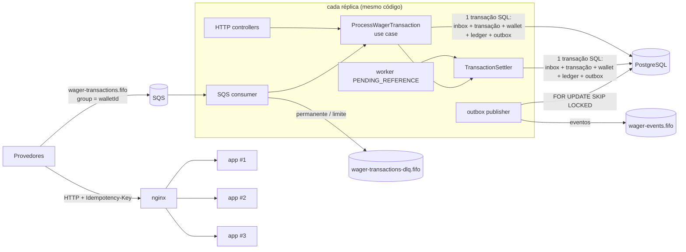

# ARCHITECTURE

Serviço financeiro que processa transações de apostas recebidas por HTTP e SQS. É correto com entregas
duplicadas, fora de ordem e concorrentes, inclusive com várias instâncias rodando ao mesmo tempo.
Este documento registra **o que** foi decidido, **por quê**, o que foi trocado por quê, e **onde está a prova**.

**Sumário**
1. [Visão geral](#1-visão-geral)
2. [Rastreabilidade: requisito → prova](#2-rastreabilidade-requisito--prova)
3. [Decisões centrais](#3-decisões-centrais) (destaque: [B](#b--uma-única-reversão-efetiva-por-referência-mais-restrito-que-o-enunciado))
4. [Domínio e regras de negócio](#4-domínio-e-regras-de-negócio)
5. [Persistência, concorrência e integridade no schema](#5-persistência-concorrência-e-integridade-no-schema)
6. [Idempotência](#6-idempotência)
7. [Mensageria: consumer, outbox, worker, shutdown](#7-mensageria-consumer-outbox-worker-shutdown)
8. [API HTTP](#8-api-http)
9. [Reconciliação](#9-reconciliação)
10. [Observabilidade](#10-observabilidade)
11. [Autenticação (não implementada; desenho)](#11-autenticação-não-implementada-desenho)
12. [Testes](#12-testes)
13. [Carga](#13-carga)
14. [Stack e ambiente](#14-stack-e-ambiente)
15. [Limitações e próximos passos](#15-limitações-e-próximos-passos)

---

## 1. Visão geral



**Uma submissão (HTTP ou SQS), numa única transação SQL READ COMMITTED:**

1. *(só SQS)* `INSERT inbox ON CONFLICT DO NOTHING`, que deduplica transporte por `(consumer, messageId)`.
2. A wallet existe? A leitura é feita sem lock, e wallets nunca são apagadas.
3. `INSERT wager_transactions (PENDING) ON CONFLICT DO NOTHING`, que deduplica negócio por idempotency key
   e por `(provider, externalId)`. Uma duplicata concorrente espera no índice único. Se não houve insert,
   faz replay do resultado gravado ou responde 409.
4. `SELECT wallet FOR NO KEY UPDATE`: o lock é por wallet, nunca global.
5. `SettlementPolicy.decide(...)` devolve uma decisão: aplicar, sem efeito, rejeitar ou aguardar referência.
6. `UPDATE wallet`, `INSERT ledger` e `UPDATE transação` (estado terminal + snapshot do saldo),
   mais o `INSERT outbox` com os eventos.
7. COMMIT. Os triggers deferred verificam saldo = último lançamento do ledger. Só então vem a resposta HTTP ou o ack SQS.

**Camadas (hexagonal):**
- **`domain/`:** TS puro, sem Nest e sem ORM; ids e relógio vêm de fora.
- **`application/`:** use cases e ports, como classes puras.
- **`infrastructure/`:** MikroORM, SQS, workers e observabilidade.
- **`interfaces/`:** controllers HTTP e consumer SQS.

O Nest só monta os use cases por factory em [app.module.ts](src/app.module.ts).

---

## 2. Rastreabilidade: requisito → prova

Todos os testes usam **Postgres e LocalStack reais**. "e2e" = `bun run test:multi` (3 réplicas atrás do nginx).

### 2.1 Falhas eliminatórias do enunciado

| Eliminatório | Como é impedido | Prova |
|---|---|---|
| `number` para dinheiro | `Money` (decimal.js, string na entrada e na saída), `NUMERIC(19,2)` mapeado como string, `canonicalJson` proíbe `number` | [money.ts](src/domain/shared/money.ts), [money.test.ts](test/unit/domain/money.test.ts), [payload-hash.test.ts](test/unit/application/payload-hash.test.ts) ("rejeita number"), [records.ts](src/infrastructure/persistence/schemas/records.ts) |
| Saldo negativo por race | lock por wallet + `CHECK (balance >= 0)` + `CHECK` do ledger + política de saldo sob lock | [hot-wallet.test.ts](test/concurrency/hot-wallet.test.ts) (100/80/80 ×20; 200 apostas em 150.00), [schema-constraints.test.ts](test/integration/schema-constraints.test.ts) ("CHECK balance >= 0") |
| Débito/crédito duplicado | insert-first com `UNIQUE (idempotency_key)` e `UNIQUE (provider_id, external_transaction_id)`, `UNIQUE (transaction_id, wallet_id)` no ledger, inbox, índice de reversão única | [same-operation.test.ts](test/concurrency/same-operation.test.ts) (50× → 1 débito), [crash-after-commit.test.ts](test/concurrency/crash-after-commit.test.ts), [restart-consistency.test.ts](test/recovery/restart-consistency.test.ts), e2e "50x" |
| Idempotência só em memória | só existe no banco: unicidade + snapshot do resultado na própria linha | [use-cases.test.ts](test/integration/use-cases.test.ts) (replay devolve saldo daquele momento), [restart-consistency.test.ts](test/recovery/restart-consistency.test.ts) (replay após restart) |
| Correto só com 1 instância | nenhum estado em memória; locks e unicidade no Postgres; `SKIP LOCKED` nos workers | [same-operation.test.ts](test/concurrency/same-operation.test.ts) (3 pools), e2e (3 réplicas, `X-Instance-Id`), [pending-reference-worker.test.ts](test/integration/pending-reference-worker.test.ts) "duas instâncias", [outbox-publisher.test.ts](test/integration/outbox-publisher.test.ts) "DOIS publishers" |
| Publicar evento antes do commit | eventos só são gravados na outbox, na mesma transação; o publisher só lê linhas confirmadas | [settle-transaction.ts](src/application/wagering/settle-transaction.ts), [outbox-publisher.test.ts](test/integration/outbox-publisher.test.ts) |
| Ledger não auditável | append-only por trigger (UPDATE/DELETE/TRUNCATE), encadeamento `balance_before = balance_after` anterior, `CHECK` aritmético, versão por lançamento, verificação deferred saldo↔ledger | [004-integrity-triggers.ts](src/infrastructure/persistence/migrations/004-integrity-triggers.ts), [schema-constraints.test.ts](test/integration/schema-constraints.test.ts), [reconciliation.test.ts](test/integration/reconciliation.test.ts) |
| Testes que mockam Postgres/SQS | nenhum mock de banco ou fila; filas exclusivas por teste; processos reais para crash/restart | [test/](test/), seção [12](#12-testes) |

### 2.2 Requisitos do enunciado

| Requisito (seção do README) | Implementação | Prova |
|---|---|---|
| Money imutável, escala 2, rejeições de entrada (6.1) | [money.ts](src/domain/shared/money.ts) | [money.test.ts](test/unit/domain/money.test.ts), [http-api.test.ts](test/integration/http-api.test.ts) ("25", "25.5", "1e2" → 400) |
| Multi-moeda, conflito de moeda testado (6.1) | `assertSameCurrency`; `CURRENCY_MISMATCH` | [money.test.ts](test/unit/domain/money.test.ts), [wallet.test.ts](test/unit/domain/wallet.test.ts), [settlement-policy.test.ts](test/unit/domain/settlement-policy.test.ts), [use-cases.test.ts](test/integration/use-cases.test.ts) |
| Construtor privado + `create`/`from`/`rehydrate` sem revalidar (6.0) | todas as entidades do domínio | [wager-transaction.test.ts](test/unit/domain/wager-transaction.test.ts) ("rehydrate não revalida") |
| 1 wallet por player+moeda; `version` começa em 1 e só sobe com saldo (6.2) | `UNIQUE (player_id, currency)`; trigger `wallets_guard` | [schema-constraints.test.ts](test/integration/schema-constraints.test.ts), [wallet.test.ts](test/unit/domain/wallet.test.ts), [use-cases.test.ts](test/integration/use-cases.test.ts) (LOSS não muda version) |
| Estados terminais e transições (6.3) | `WagerTransaction` + trigger `wager_transactions_guard` | [wager-transaction.test.ts](test/unit/domain/wager-transaction.test.ts), [schema-constraints.test.ts](test/integration/schema-constraints.test.ts) ("estado terminal é imutável") |
| OPENING interno, na mesma transação SQL (6.3, 9) | `OpenWalletUseCase` | [use-cases.test.ts](test/integration/use-cases.test.ts) (wallet v1 + OPENING + CREDIT + 2 eventos) |
| Ledger imutável estrutural, 1 lançamento por wallet (6.4) | `Object.freeze`, `UNIQUE (transaction_id, wallet_id)` | [wallet.test.ts](test/unit/domain/wallet.test.ts) ("imutabilidade estrutural"), [schema-constraints.test.ts](test/integration/schema-constraints.test.ts) |
| Regras BET/WIN/LOSS/REFUND/ROLLBACK (7) | [settlement-policy.ts](src/domain/wagering/settlement-policy.ts) | [settlement-policy.test.ts](test/unit/domain/settlement-policy.test.ts), [use-cases.test.ts](test/integration/use-cases.test.ts) |
| Reversão única; valor igual; mesmo contexto (7.2–7.5) | política + `wt_single_reversal_uq` + FK composta de referência | [settlement-policy.test.ts](test/unit/domain/settlement-policy.test.ts), [hot-wallet.test.ts](test/concurrency/hot-wallet.test.ts) ("REFUND e ROLLBACK da MESMA BET em paralelo") |
| Reversão que estoura saldo, código distinto (7.9) | `REVERSAL_WOULD_OVERDRAW` | [settlement-policy.test.ts](test/unit/domain/settlement-policy.test.ts), [use-cases.test.ts](test/integration/use-cases.test.ts) |
| Replay devolve o resultado original com o saldo do momento (7.7) | snapshot `result_balance` na linha da transação | [use-cases.test.ts](test/integration/use-cases.test.ts), [http-api.test.ts](test/integration/http-api.test.ts) (mesmo status e corpo: 200/422/202) |
| Referência fora de ordem, worker, backoff, limite → REJECTED + evento (7.1) | [resolve-pending-references.ts](src/application/wagering/resolve-pending-references.ts) | [pending-reference-worker.test.ts](test/integration/pending-reference-worker.test.ts), [restart-consistency.test.ts](test/recovery/restart-consistency.test.ts) |
| failureCodes estáveis (7.2) | [failure-code.ts](src/domain/wagering/failure-code.ts) | seção [4.4](#44-taxonomia-de-failurecode) |
| Concorrência por wallet; cenário 100/80/80 (8) | `FOR NO KEY UPDATE` (decisão A) | [hot-wallet.test.ts](test/concurrency/hot-wallet.test.ts), [distinct-wallets.test.ts](test/concurrency/distinct-wallets.test.ts) ("wallet A travada não bloqueia B"), [wallet-lock-mode.test.ts](test/integration/wallet-lock-mode.test.ts), e2e |
| ≥ 3 instâncias (8, 13) | compose `replicas: 3` + nginx | e2e [multi-instance.e2e.ts](test/e2e/multi-instance.e2e.ts) |
| Unicidade, imutabilidade e não-negatividade **no schema** (5.9) | migrations 001–005 | [schema-constraints.test.ts](test/integration/schema-constraints.test.ts) (20 testes só com SQL) |
| Migrations versionadas e reversíveis (4) | [migrations/](src/infrastructure/persistence/migrations) | [schema-constraints.test.ts](test/integration/schema-constraints.test.ts) ("são reversíveis") |
| Endpoints e cursor estável e opaco (9) | controllers HTTP, [queries.ts](src/application/queries.ts) | [http-api.test.ts](test/integration/http-api.test.ts) (cursor estável com inserções entre páginas) |
| Status HTTP distintos e consistentes (9) | `HttpErrorFilter` + status pelo resultado | [http-api.test.ts](test/integration/http-api.test.ts), [transient-failures.test.ts](test/integration/transient-failures.test.ts) (503 + Retry-After) |
| Idempotency key, payloadHash canônico, 409 em conflito (9) | seção [6](#6-idempotência) | [payload-hash.test.ts](test/unit/application/payload-hash.test.ts), [use-cases.test.ts](test/integration/use-cases.test.ts), [same-operation.test.ts](test/concurrency/same-operation.test.ts) |
| Reconciliação: loga, mede e sinaliza sem corrigir (9) | [reconcile-wallet.ts](src/application/wallets/reconcile-wallet.ts) | [reconciliation.test.ts](test/integration/reconciliation.test.ts) (divergência forçada com `session_replication_role = replica`) |
| Health live/ready abertos; ready = Postgres + SQS (9, 12) | [health.controller.ts](src/interfaces/http/health.controller.ts) | [observability.test.ts](test/integration/observability.test.ts), [http-api.test.ts](test/integration/http-api.test.ts) |
| Consumer: mesmo use case, inbox, ack após commit, negócio/transitório/permanente, limite → DLQ, SIGTERM, redelivery (10) | [wager-transaction.consumer.ts](src/interfaces/sqs/wager-transaction.consumer.ts) | [sqs-consumer.test.ts](test/integration/sqs-consumer.test.ts), [crash-after-commit.test.ts](test/concurrency/crash-after-commit.test.ts), e2e (SIGTERM) |
| Outbox atômica; publishers concorrentes; crash antes de publicar (11) | [outbox-publisher.ts](src/infrastructure/workers/outbox-publisher.ts) | [outbox-publisher.test.ts](test/integration/outbox-publisher.test.ts), [restart-consistency.test.ts](test/recovery/restart-consistency.test.ts) |
| Eventos: classe abstrata + subclasses; `data` com MoneyProps; BalanceChanged só se o saldo mudou (11) | [wagering-events.ts](src/domain/events/wagering-events.ts) | [messaging.test.ts](test/unit/domain/messaging.test.ts), [use-cases.test.ts](test/integration/use-cases.test.ts) (LOSS sem BalanceChanged) |
| Logs JSON com ids, sem payload financeiro (12) | pino + AsyncLocalStorage | [observability.test.ts](test/integration/observability.test.ts) |
| Métricas mínimas (12) | [metrics.ts](src/infrastructure/observability/metrics.ts) | [observability.test.ts](test/integration/observability.test.ts), [transient-failures.test.ts](test/integration/transient-failures.test.ts) |
| Concorrência 1–8 (13) | — | 1: [same-operation](test/concurrency/same-operation.test.ts) · 2: [hot-wallet](test/concurrency/hot-wallet.test.ts) · 3: [distinct-wallets](test/concurrency/distinct-wallets.test.ts) · 4: e2e · 5: [crash-after-commit](test/concurrency/crash-after-commit.test.ts) · 6: [outbox-publisher](test/integration/outbox-publisher.test.ts) · 7: [pending-reference-worker](test/integration/pending-reference-worker.test.ts) · 8: [restart-consistency](test/recovery/restart-consistency.test.ts) |
| Invariante final `balance == ledger` em todos | `assertLedgerInvariant()` | [app-context.ts](test/support/app-context.ts); chamada nos testes de concorrência, integração, recuperação e e2e |
| Teste de carga (diferencial) | `bun run test:load` | [load-test-report.md](docs/load-test-report.md), [load-test-analysis.md](docs/load-test-analysis.md) |

---

## 3. Decisões centrais

### ⚠️ B — Uma única reversão efetiva por referência (mais restrito que o enunciado)

O enunciado exige que "uma referência não pode ser revertida duas vezes **pelo mesmo tipo de operação**".
Aplicada ao pé da letra, essa regra permite:

```
BET 100        → saldo -100
REFUND(BET)    → saldo +100   (1ª reversão, kind REFUND)
ROLLBACK(BET)  → saldo +100   (2ª reversão, kind ROLLBACK)  ← crédito duplicado
```

Crédito duplicado é falha eliminatória. Por isso o schema impõe **no máximo uma reversão `PROCESSED`
por referência, de qualquer kind**:

```sql
CREATE UNIQUE INDEX wt_single_reversal_uq ON wager_transactions (reference_transaction_id)
  WHERE status = 'PROCESSED' AND kind IN ('REFUND','ROLLBACK');
```

- Cobre a regra do enunciado: dois REFUND da mesma BET continuam impossíveis.
- `ROLLBACK(REFUND)` continua permitido, porque referencia o REFUND e não a BET.
- A segunda tentativa é rejeitada com `REFERENCE_ALREADY_REVERSED`. Rejeitadas não entram no índice
  parcial, então várias tentativas recusadas ficam auditáveis.
- **Provas:**
  - [schema-constraints.test.ts](test/integration/schema-constraints.test.ts): "índice parcial..."
  - [hot-wallet.test.ts](test/concurrency/hot-wallet.test.ts): 4 reversões concorrentes da mesma BET
    em 10 rodadas, exatamente 1 vence.

### A — Lock da wallet com `FOR NO KEY UPDATE`

**O problema.** O fluxo é insert-first: o `INSERT` em `wager_transactions` valida a FK `wallet_id` e,
para isso, o Postgres pega `FOR KEY SHARE` na wallet. `FOR UPDATE` conflita com `FOR KEY SHARE`,
então dois escritores na mesma wallet entram num ciclo de espera:

1. A e B inserem cada um a sua transação; os dois seguram KEY SHARE na wallet.
2. A pede FOR UPDATE e espera B.
3. B pede FOR UPDATE e espera A. O Postgres detecta o deadlock e aborta uma delas com `40P01`.

**A solução.** `FOR NO KEY UPDATE` serializa os escritores entre si (é o mesmo lock que o próprio
`UPDATE balance` pega, já que nenhuma coluna de chave muda) e não conflita com KEY SHARE.

**Prova:** [wallet-lock-mode.test.ts](test/integration/wallet-lock-mode.test.ts) reproduz os dois casos
no Postgres real.

**Implementação:**
- Como o `LockMode` do MikroORM só gera `FOR UPDATE`, esse lock é SQL explícito no repositório.
- `LockMode.PESSIMISTIC_PARTIAL_WRITE` (`FOR UPDATE SKIP LOCKED`) é usado na outbox e no worker de referências.

### C — `INSERT ... ON CONFLICT DO NOTHING` no insert-first

No Postgres, um erro dentro da transação a aborta, então capturar `unique_violation` exigiria savepoint.
`ON CONFLICT DO NOTHING` mantém a mesma semântica: uma duplicata concorrente **espera** no índice único
até a original confirmar ou desfazer. Se a original desfizer, a duplicata assume. A seção [6](#6-idempotência)
mostra a tabela de desfechos.

### D — `WALLET_NOT_FOUND` não é persistido

A FK `wager_transactions.wallet_id → wallets`: escolhi integridade referencial em vez de permitir transações órfãs.
- **HTTP:** responde 422 `WALLET_NOT_FOUND`.
- **SQS:** é erro de negócio, com **ack e sem inbox**. A exceção desfaz a transação, mas não há efeito
  financeiro a proteger: uma redelivery só recalcula o mesmo resultado, e se a wallet tiver sido criada
  nesse meio-tempo, processa corretamente.

### E — Códigos além do enunciado

- `PLAYER_MISMATCH`, `REFERENCE_NOT_PROCESSED`, `WALLET_NOT_FOUND`;
- `PROCESSING_FAILED`, o único código do estado FAILED.

### F — Eventos em `wager-events.fifo`

`MessageGroupId = aggregateId` e `MessageDeduplicationId = eventId`. O README não define o destino dos eventos.

### G — Outbox nunca descarta

O backoff exponencial tem teto de 5 min, e o evento **nunca** é descartado: perder evento confirmado é
eliminatório. O atraso fica visível em `wagering_outbox_lag_seconds`.

O limite de tentativas vale para PENDING_REFERENCE (seção [7.4](#74-worker-de-pending_reference)).

### H — Itens menores
- **Validação:** zod `strict` (seção [8](#8-api-http)).
- **Balanceamento:** nginx na frente das 3 réplicas.
- **Ledger:** paginado em ordem decrescente de `wallet_version`.
- **Testes:** usam ids próprios, sem `TRUNCATE`, que o ledger bloqueia.

---

## 4. Domínio e regras de negócio

### 4.1 Money
- **Implementação:** `decimal.js` num construtor **isolado** (`Decimal.clone`, precisão 40), sem alterar
  a configuração global da lib. Com 19 dígitos, `add`/`subtract` são sempre exatos.
- **Escala fixa no contrato**, como diz o README: `amount` tem **exatamente 2 casas** (`"25.00"`).
  `"25"` e `"25.5"` são rejeitados com 400. Mais de 2 casas também é **rejeitado, nunca arredondado**,
  porque arredondar dinheiro em silêncio esconde erro do provedor.
- **Também rejeitados:** sinal, notação científica, `NaN`/`Infinity`, vazio, zero à esquerda, espaços,
  vírgula, valor que não seja string e valor acima da faixa de NUMERIC(19,2).
- **Negativos:** só por aritmética interna (`negate`/`subtract`, por exemplo a diferença da reconciliação),
  nunca pela entrada.
- **Persistência:** o Postgres devolve `numeric` como **string**, mapeado com `p.decimal('string')`.
  Em nenhum ponto o valor passa por `number`. Somas de reconciliação são feitas em NUMERIC e devolvidas como texto.
- **Banco:** `NUMERIC(19,2)` + `currency CHAR(3)`. O FK composto `(wallet_id, currency)` garante que o
  lançamento está na moeda da wallet.

### 4.2 Regras e interpretações
**Ordem de verificação** na [SettlementPolicy](src/domain/wagering/settlement-policy.ts):
1. player e moeda da wallet;
2. contexto da referência;
3. kind da referência;
4. status da referência;
5. valor e reversão anterior;
6. saldo.

O que invalida a operação para sempre é verificado antes do que depende de estado. A política é uma
função pura que **decide** e não executa: aplicar, sem efeito, rejeitar ou aguardar.

| Kind | Efeito | Ledger | Observação |
|---|---|---|---|
| BET | débito | DEBIT | sem saldo → `INSUFFICIENT_FUNDS` |
| WIN | crédito | CREDIT | referência opcional à BET da rodada, com qualquer valor |
| LOSS | nenhum | nenhum | valor ≥ 0; não muda `version`; só `WagerTransactionProcessed` |
| REFUND | crédito | CREDIT | só referencia BET PROCESSED; valor igual; uma vez |
| ROLLBACK | inverso da referência | invertido | BET → crédito; WIN/REFUND → débito; estouro de saldo → `REVERSAL_WOULD_OVERDRAW` |
| OPENING | crédito | CREDIT | interno; criado com a wallet; não pode ser submetido |

- **⚠️ Extensão: LOSS com referência.** O README não prevê referência em LOSS. Ela é aceita
  opcionalmente, com as mesmas checagens do WIN (contexto e kind BET), em vez de ser ignorada.
- **⚠️ WIN rejeitado por referência ausente.** Um WIN **com** referência cuja BET nunca chega fica em
  PENDING_REFERENCE durante a janela do worker (10 tentativas, cerca de 3 min). Depois vira
  `REJECTED`/`REFERENCE_NOT_FOUND`, **sem crédito**, e emite o evento.
  - A referência declarada é tratada como pré-condição. É o comportamento conservador:
    não credita prêmio de aposta que não existe.
  - Contrapartida: um prêmio legítimo com referência errada fica retido; o provedor reenvia com novo
    `externalTransactionId`.
  - LOSS segue a mesma regra, sem efeito financeiro.
- **Referência em outro contexto.** Referência de outra wallet, player ou rodada é rejeitada com
  `REFERENCE_MISMATCH` **sem gravar** `reference_transaction_id`, porque a FK composta só aceita
  referência da mesma wallet.
- **Referência existente, mas PENDING_REFERENCE** (ex.: ROLLBACK de um REFUND que ainda espera a BET):
  a transação também aguarda. As cadeias se resolvem em ordem causal.
- **Snapshot do resultado** (`result_balance`, `result_wallet_version`): gravado em toda transação
  PROCESSED e REJECTED. É o que o replay devolve, inclusive para LOSS e REJECTED, que não têm ledger.

### 4.3 Estados
```
PENDING ──► PROCESSED | REJECTED | FAILED
   └─────► PENDING_REFERENCE ──► PENDING_REFERENCE (nova tentativa) ──► PROCESSED | REJECTED | FAILED
```
PENDING só existe dentro da transação SQL. Os estados terminais são congelados no domínio
(`InvalidTransactionStateError`) **e** no banco (trigger `WT001`).

### 4.4 Taxonomia de failureCode
| Código | Ação do provedor | Quando |
|---|---|---|
| `INSUFFICIENT_FUNDS` | retry_later (nova transação) | BET maior que o saldo |
| `REVERSAL_WOULD_OVERDRAW` | give_up (operacional) | ROLLBACK que debitaria (de WIN/REFUND) deixaria saldo negativo |
| `REFERENCE_NOT_FOUND` | fix_payload | referência não chegou dentro da janela |
| `REFERENCE_MISMATCH` | fix_payload | referência de outro player/wallet/moeda/rodada |
| `REFERENCE_ALREADY_REVERSED` | give_up | já existe reversão efetiva (decisão B) |
| `REFERENCE_NOT_PROCESSED` | give_up | referência REJECTED/FAILED |
| `AMOUNT_MISMATCH` | fix_payload | valor da reversão ≠ valor da referência |
| `CURRENCY_MISMATCH` | fix_payload | moeda da operação ≠ moeda da wallet |
| `INVALID_REFERENCE_KIND` | fix_payload | REFUND→BET; ROLLBACK→BET/WIN/REFUND; WIN/LOSS→BET |
| `PLAYER_MISMATCH` | fix_payload | wallet não pertence ao player |
| `WALLET_NOT_FOUND` | fix_payload | walletId inexistente (não persistido) |
| `PROCESSING_FAILED` | retry_later (nova transação) | status FAILED |

Toda rejeição é terminal **para aquela Idempotency-Key**: reenviar com a mesma key devolve o mesmo
resultado. "retry_later" significa enviar uma *nova* transação.

---

## 5. Persistência, concorrência e integridade no schema

### 5.1 Garantias no schema
Migrations em [migrations/](src/infrastructure/persistence/migrations), todas com `down`.
Cada uma das garantias abaixo tem teste só com SQL em [schema-constraints.test.ts](test/integration/schema-constraints.test.ts).

| Garantia | Mecanismo |
|---|---|
| Saldo nunca negativo | `CHECK (balance >= 0)`; `CHECK` de saldos não negativos no ledger |
| Uma wallet por player+moeda | `UNIQUE (player_id, currency)` |
| Idempotência | `UNIQUE (idempotency_key)`, `UNIQUE (provider_id, external_transaction_id)` |
| No máximo um lançamento por transação | `UNIQUE (transaction_id, wallet_id)` no ledger |
| Aritmética do lançamento | `CHECK (balance_before ± amount = balance_after)` |
| Ledger append-only | trigger bloqueia UPDATE, DELETE e TRUNCATE (`WL001`) |
| Ledger encadeado | trigger: `balance_before` = `balance_after` anterior; `UNIQUE (wallet_id, wallet_version)` |
| Lançamento na moeda da wallet | FK `(wallet_id, currency) → wallets(id, currency)` |
| Saldo = último lançamento (no COMMIT) | constraint trigger `DEFERRABLE INITIALLY DEFERRED` (`WL004`) |
| `version` começa em 1 e sobe +1 só com o saldo | trigger `wallets_guard` (`WL003`) |
| Wallet e transação nunca apagadas | triggers |
| Estado terminal e campos de negócio imutáveis | trigger `wager_transactions_guard` (`WT001`) |
| Referência na mesma wallet | FK `(reference_transaction_id, wallet_id) → wager_transactions(id, wallet_id)` |
| Reversão única por referência | índice único parcial (decisão B) |
| Um OPENING por wallet | índice único parcial |
| Dedup da inbox | `PRIMARY KEY (consumer_name, message_id)` |
| Coerência de campos | `CHECK`s: referência exigida em REFUND/ROLLBACK e proibida em BET/OPENING; `failure_code` ⇔ REJECTED/FAILED; snapshot ⇔ PROCESSED/REJECTED |

### 5.2 Transação e locks
- **Isolamento:** READ COMMITTED + `FOR NO KEY UPDATE` por wallet. A serialização vem do lock,
  não do isolamento. Com SERIALIZABLE, todo conflito em hot wallet viraria abort (`40001`) e retry caro,
  em vez de uma espera curta.
- **Escritas:** nativas (`em.insert`/`nativeUpdate`) em vez de `flush`. A ordem dos comandos importa
  (FKs e trigger de encadeamento) e fica explícita. `em.transactional` delimita a transação.
  As leituras usam `disableIdentityMap`.
- **Retry da unit of work:** repete a transação inteira para `40001`, `40P01`, `55P03` e para violação de
  `wt_single_reversal_uq` (uma corrida perdida; na nova tentativa a regra devolve `REFERENCE_ALREADY_REVERSED`).
  - Até 5 tentativas, com backoff de 10–200 ms e jitter, cada uma num `fork` novo do EntityManager.
  - **Cada retry** incrementa `wagering_db_lock_conflicts_total{sqlstate}` e gera log `warn`.
  - Esgotadas as tentativas: **503 com `Retry-After: 1`**.
- **`lock_timeout` por transação** (`SET LOCAL`, 5 s): sem teto, uma hot wallet empilharia conexões
  esperando indefinidamente. Com ele, a espera vira `55P03`, depois retry e, se persistir, 503:
  degradação explícita e mensurável. Prova: [transient-failures.test.ts](test/integration/transient-failures.test.ts).
- **Classificação de erros:** por SQLSTATE e nome de constraint, nunca por mensagem ([pg-errors.ts](src/infrastructure/persistence/pg-errors.ts)).
- **Ids:** UUIDv7 (`Bun.randomUUIDv7`): ordenáveis por tempo e sem coordenação entre instâncias.

---

## 6. Idempotência

- **Fonte da verdade:** o header `Idempotency-Key` (HTTP) ou `data.idempotencyKey` (SQS), gravado em
  `UNIQUE (idempotency_key)`. Nada fica em memória.
- **payloadHash:** `hex(SHA-256(UTF-8(canonicalJson({ v: "wager-payload/v1", ...campos de negócio }))))`.
  - Campos de negócio: providerId, externalTransactionId, playerId, walletId, roundId, gameId, kind,
    money, referenceExternalTransactionId.
  - Ficam fora: a key, messageId, occurredAt e correlationId.
  - JSON canônico: chaves ordenadas recursivamente, `undefined` omitido e `number` proibido.
  - A versão do algoritmo entra no conteúdo hasheado, para poder evoluir.

| Situação após `ON CONFLICT DO NOTHING` | Resposta |
|---|---|
| mesma key, mesmo hash | replay do resultado gravado (status e corpo originais, `idempotentReplay: true`) |
| mesma key, hash diferente | 409 `IDEMPOTENCY_KEY_PAYLOAD_MISMATCH` |
| mesmo `(provider, externalId)`, outra key | 409 `EXTERNAL_TRANSACTION_ID_CONFLICT` |

**No SQS, duas camadas:**
- **inbox** (transporte): mesmo messageId → nenhum efeito novo. Mesmo messageId com conteúdo
  diferente → `INBOX_PAYLOAD_MISMATCH` → DLQ.
- **idempotency key** (negócio): o provedor reenviou a mesma operação com outro messageId.

---

## 7. Mensageria: consumer, outbox, worker, shutdown

### 7.1 Consumer SQS ([wager-transaction.consumer.ts](src/interfaces/sqs/wager-transaction.consumer.ts))
- **Mesmo use case do HTTP:** `executeFromMessage` = mesmo `process()` + inbox na **mesma transação SQL**.
- **Envelope tolerante, `data` estrito:**
  - no envelope só `data` é obrigatório; campos extras passam (uma mudança de envelope do produtor
    não pode mandar dinheiro para a DLQ);
  - sem `messageId`, usa o `MessageId` do SQS;
  - `data` é zod `strict`, com `idempotencyKey`.
- **Ack só depois do commit.** Um crash entre o commit e o ack causa redelivery, que a inbox reconhece:
  nenhum efeito novo. Provado com processo real morto com `exit 137` no hook pós-commit.
- **Ordem:** sequencial **dentro** de um `MessageGroupId` (walletId), paralela entre grupos. Uma mensagem
  em retry segura a fila daquela wallet, que é o comportamento FIFO.

| Erro | Ação | FAILED? |
|---|---|---|
| REJECTED (negócio), `WALLET_NOT_FOUND` | ack | — |
| JSON/envelope/`data` inválido, `INVALID_MONEY`, conflito de idempotência, `INBOX_PAYLOAD_MISMATCH` | DLQ (motivo em atributo) | não: não há transação válida e única |
| transitório **ou não classificado**, `receiveCount < 5` | `ChangeMessageVisibility` com backoff (1 s → 60 s) | — |
| transitório ou não classificado **no 5º recebimento** | FAILED (transação separada) e depois DLQ (`retries_exhausted` / `unexpected_error`) | sim |

- **Erro não classificado também passa por retry:** FAILED é terminal, então não pode nascer de um erro
  desconhecido na 1ª tentativa. Ele pode ser uma falha de infraestrutura não mapeada que passa sozinha.
  Prova: "falha inesperada na 1ª tentativa NÃO gera FAILED" em [sqs-consumer.test.ts](test/integration/sqs-consumer.test.ts).
- **Limite vs. redrive:** o consumer desiste no 5º recebimento, e o redrive do SQS (`maxReceiveCount=5`)
  só moveria no 6º. O redrive é a rede de segurança para crash loop.
- **DLQ:** recebe o corpo original, o mesmo grupo, dedup pelo id SQS original e os atributos
  `failureReason`, `receiveCount` e `originalMessageId`. Só depois a mensagem é apagada da origem.

### 7.2 FAILED
- **Quem grava:**
  - o consumer, no limite de recebimentos;
  - o worker de referências, quando uma linha lança erro não transitório. Sem isso, uma "linha
    venenosa" seria reivindicada em loop.
- **Como:** numa **transação separada, curta e best-effort**. O HTTP nunca grava FAILED: ele responde 503.
- **Não trava a wallet** (só o KEY SHARE da FK), então funciona mesmo quando a causa é a wallet disputada.
  Não sobrescreve transação existente.
- **Sem evento de integração:** FAILED não está na lista do enunciado. O sinal é a DLQ e
  `wagering_dlq_messages_total{reason}`.
- **Replay:** devolve 422 `PROCESSING_FAILED`.

### 7.3 Visibilidade: heartbeat + validação no startup
- **Heartbeat:** enquanto uma mensagem é processada, o consumer renova a visibilidade a cada 1/3 do
  timeout. Se o processo morrer, o heartbeat morre junto e a mensagem volta normalmente.
  Prova por **mutação**: desligando o heartbeat, o teste "outro consumer NÃO recebe a mensagem" falha
  (a mensagem foi recebida 2×).
- **Validação no startup** ([config.ts](src/infrastructure/config.ts)): a instância **não sobe** se
  `visibilityTimeout < 1,5 × pior caso`.
  - Pior caso = (tentativas da unit of work + 1 da gravação do FAILED) × `lock_timeout` + backoff entre tentativas.
  - Com os defaults, isso dá (5+1) × 5 s + 150 ms = 30,15 s, o que exige ≥ 46 s. Por isso o padrão é **60 s**.
  - O heartbeat cobre lentidões fora do previsto; a validação garante a folga mesmo que um heartbeat falhe.
- **Provisionamento convergente:** `CreateQueue` só com os atributos imutáveis da FIFO, depois
  `SetQueueAttributes` com visibilidade e redrive. Mudar a configuração ajusta filas já existentes.

### 7.4 Worker de PENDING_REFERENCE
- **Claim:** reivindica **uma** linha vencida por transação (`FOR UPDATE SKIP LOCKED`), trava a wallet
  e aplica o **mesmo** `TransactionSettler` da submissão. N instâncias dividem o trabalho sem coordenação.
- **Janela:** 10 tentativas, base 500 ms ×2, teto 30 s, jitter de 20%, cerca de 3 min no total.
  Fora de ordem em provedores é questão de segundos; minutos cobrem atraso de fila sem prender a
  transação indefinidamente. Ao esgotar: `REJECTED`/`REFERENCE_NOT_FOUND` + `WagerTransactionRejected`.
- **Evento:** `WagerTransactionPendingReference` só na **entrada**; reagendamentos não repetem.
- **Falhas:** erro transitório deixa a linha pendente para o próximo ciclo; erro não transitório a torna FAILED.

### 7.5 Outbox publisher
- **Reivindicação:** `em.find(..., { lockMode: LockMode.PESSIMISTIC_PARTIAL_WRITE })`, que gera
  `FOR UPDATE SKIP LOCKED`. Lotes de 100: com 10, o publisher não acompanhou cerca de 470 eventos/s
  (lag de 19 s no teste de carga; com 100, 0,84 s).
- **Trade-off: a transação fica aberta durante o publish.** `SendMessageBatch` e a marcação
  `published_at` acontecem na mesma transação.
  - Custo: uma conexão e os locks ficam presos durante I/O de rede.
  - Um crash entre o send e o commit gera republicação. É aceitável: at-least-once por contrato,
    dedup por `eventId` no consumidor e pela FIFO (janela de 5 min).
  - Alternativa: lease (`claimed_until`) com duas transações curtas.
- **Ordem:** entre publishers concorrentes, a ordem por agregado **não** é garantida. Os consumidores usam
  `walletVersion` para ordenar e `eventId` para deduplicar.

### 7.6 SIGTERM
1. O Nest chama `beforeApplicationShutdown` **antes** de o ORM fechar o pool.
2. O consumer para de receber (aborta o long polling) e conclui o que está em andamento
   (`SHUTDOWN_GRACE_MS`, 20 s).
3. As mensagens recebidas que não começaram voltam **na hora** para a fila (visibilidade 0).
4. O que passar do prazo volta pela expiração da visibilidade.
5. Os workers param no fim do tick, nunca no meio de uma transação.

No compose: `init: true` (tini como PID 1, porque o Nest re-emite o sinal após o shutdown) e
`stop_grace_period: 30s`.

**Provas:**
- [sqs-consumer.test.ts](test/integration/sqs-consumer.test.ts);
- e2e: `docker kill --signal SIGTERM` numa réplica durante 120 mensagens. Resultado: shutdown cooperativo
  nos logs, saída 143, nada perdido ou duplicado, e a réplica volta healthy após `docker start`.
  O Docker não aplica restart policy após `docker kill`; em produção, quem recria é o orquestrador.

---

## 8. API HTTP

| Status | Significado | O provedor deve |
|---|---|---|
| 200 | PROCESSED (primeira vez **ou** replay; `idempotentReplay` distingue) | seguir |
| 201 | wallet criada | seguir |
| 202 | PENDING_REFERENCE | aguardar; consultar o GET ou o evento |
| 400 | payload, header ou parâmetro inválido | corrigir |
| 404 | recurso de consulta inexistente | — |
| 409 | `IDEMPOTENCY_KEY_PAYLOAD_MISMATCH`, `EXTERNAL_TRANSACTION_ID_CONFLICT`, `WALLET_ALREADY_EXISTS` | não reenviar igual |
| 422 | REJECTED/FAILED com `failureCode` (mesmo corpo no replay) | ver taxonomia |
| 503 | falha transitória (`Retry-After`) | reenviar com a **mesma** key |

- **Status do replay:** sai do **resultado**. O replay recebe o mesmo status **e** o mesmo corpo da
  primeira resposta, exceto `idempotentReplay`; há teste para 200, 422 e 202 e para `WALLET_NOT_FOUND`.
  Por isso nenhum corpo de resultado tem campo volátil: o correlationId vai no header `X-Correlation-Id`.
- **Mapeamento único:** o `HttpErrorFilter` faz o mapeamento categoria → status para todos os endpoints.
- **zod `strict`:** campo desconhecido gera 400. Num WIN, um typo em `referenceExternalTransactionId`
  seria descartado em silêncio. O conteúdo do dinheiro é validado só pelo `Money` (fonte única).
- **Cursor do ledger:** `base64url({ w: walletId, v: wallet_version })`, em ordem decrescente.
  É estável, porque `wallet_version` é imutável e único (inserções não deslocam páginas). Um cursor de
  outra wallet resulta em 400.
- **Balanceamento:** nginx com `proxy_next_upstream off`. O proxy não reenvia POST para outra réplica;
  reenviar é decisão do cliente, que tem a key.

---

## 9. Reconciliação

`POST /wallets/:id/reconciliation` ([reconcile-wallet.ts](src/application/wallets/reconcile-wallet.ts)):
- **Snapshot:** **uma** instrução SQL lê a wallet e os agregados do ledger. O resultado é consistente
  mesmo em READ COMMITTED, **sem travar** a wallet, então não bloqueia o fluxo financeiro.
- **Comparação:** `calculated = créditos − débitos` (cada um `Money` não negativo) e
  `difference = stored − calculated`, que pode ser negativa. `consistent` exige saldo **e** versão
  iguais aos do ledger.
- **Resposta:** os campos do enunciado, mais `walletVersion` e `ledgerVersion`.
- **Não corrige.** Divergência é sintoma de bug ou de escrita fora da aplicação, e consertar em silêncio
  apagaria a evidência. A aplicação loga `error` (`reconciliation mismatch`, com walletId, diferença,
  versões e correlationId), incrementa `wagering_reconciliation_mismatches_total` e responde `consistent: false`.
- **Prova:** [reconciliation.test.ts](test/integration/reconciliation.test.ts). A divergência é forçada de
  verdade com `SET LOCAL session_replication_role = replica`, que desliga os triggers inclusive a verificação
  deferred. O teste verifica a diferença exata (positiva, negativa e só de versão), a linha de log, a métrica
  e que o saldo **não** foi alterado.

---

## 10. Observabilidade

- **Logs JSON (pino):**
  - toda linha carrega `correlationId`, `messageId`, `transactionId`, `walletId` e `providerId` do escopo
    corrente, via **AsyncLocalStorage** (`mixin`);
  - os escopos são abertos no middleware HTTP, por mensagem no consumer, e enriquecidos à medida que os ids
    ficam conhecidos;
  - o próprio Nest loga pelo mesmo pino (`PinoNestLogger`, `bufferLogs`);
  - cada requisição gera uma linha (método, rota, status, duração; `warn` para 4xx, `error` para 5xx;
    sem probes de health e scrape).
- **Sem payload financeiro:**
  - os call sites logam ids e status;
  - `redact` mascara `money`/`balance`/`amount`/`body`/`payload`/`data` se alguém logar um objeto inteiro;
  - o teste verifica que os valores usados (ex.: `123.45`) não aparecem em nenhuma linha.
- **Métricas** (`GET /metrics`, um registry por instância):

| Métrica | O que mede |
|---|---|
| `wagering_transactions_total{status,source,replay}` | transações por status e origem |
| `wagering_duplicates_detected_total{layer}` | duplicatas: `idempotency` / `inbox` |
| `wagering_db_lock_conflicts_total{sqlstate}` | **cada** retry por conflito de lock |
| `wagering_db_retries_exhausted_total` | unidades de trabalho que desistiram (503 / retry SQS) |
| `wagering_sqs_messages_total{outcome}`, `wagering_sqs_retries_total` | desfecho de cada mensagem; retries |
| `wagering_dlq_messages_total{reason}` | mensagens movidas para a DLQ |
| `wagering_outbox_lag_seconds`, `..._pending_messages`, `..._published_total`, `..._publish_failures_total` | outbox |
| `wagering_pending_reference_resolutions_total{result}` | tentativas do worker |
| `wagering_reconciliation_mismatches_total` | divergências encontradas |
| `wagering_processing_duration_seconds{source}` | latência (histograma) |

- **Health:**
  - `/health/live` só verifica o processo; nunca consulta dependências, senão uma queda do banco
    reiniciaria todas as réplicas.
  - `/health/ready` verifica Postgres e SQS em paralelo, com timeout curto.
  - Os dois são `@Public`.

---

## 11. Autenticação (não implementada; desenho)

Fora do escopo por decisão: não vale pontos e não deve competir com correção financeira. O ponto de
extensão já existe e está ligado globalmente: [ProviderAuthGuard](src/interfaces/http/auth.guard.ts),
um guard no-op com `@Public()` nos health checks.

**Desenho previsto com Keycloak/OIDC:**
1. **Cliente por provedor:** cada provedor é um *client* confidencial no realm e obtém um JWT curto
   via `client_credentials`.
2. **Validação no guard:**
   - assinatura via **JWKS** do realm, com cache e rotação por `kid`;
   - `iss`, `aud` e `exp`;
   - o `providerId` vem do claim `azp`/`client_id`.
3. **Autorização:** `body.providerId` (e o prefixo da Idempotency-Key) precisa ser igual ao provedor do
   token. Divergência resulta em **403**, antes de tocar no banco. Isso impede que um provedor submeta
   ou consulte transações de outro.
4. **Wallets:** criação e consulta de wallet exigiriam um escopo próprio (operador/backoffice), separado
   dos provedores.
5. **SQS:** é canal interno confiável. A identidade do provedor contida na mensagem continua sujeita às
   mesmas validações de domínio (contexto da referência, player da wallet).

Trocar o guard por essa implementação não altera controllers nem use cases.

---

## 12. Testes

| Suíte | Comando | O que cobre |
|---|---|---|
| Unidade | `bun run test:unit` | Money, Wallet, ledger, máquina de estados, política por kind, eventos, backoff, payloadHash, timing do consumer |
| Integração | `bun run test:integration` | schema (SQL puro), use cases, HTTP, consumer, outbox, worker, reconciliação, logs, 503 |
| Concorrência | `bun run test:concurrency` | barreira + 3 pools; 50× mesma aposta; 100/80/80 ×20; hot wallet; reversões concorrentes; crash após commit (processo real) |
| Recuperação | `bun run test:recovery` | processo real da app morto com kill -9 no meio da carga, restart, reenvio com as mesmas keys |
| **≥ 3 instâncias** | **`bun run test:multi`** | compose com 3 réplicas + nginx; distribuição comprovada por `X-Instance-Id`; consumers concorrentes; SIGTERM |
| Tudo | **`bun run test:all`** | `test` + `test:multi` |
| Carga | `bun run test:load` | seção [13](#13-carga) |

**Princípios:**
- **Infraestrutura real em tudo.** Os únicos "dublês":
  - um spy que **delega** ao gateway SQS real, para contar envios por eventId;
  - duas injeções de falha de *programação* (TypeError) sobre banco e fila reais, para provar a
    classificação de erros.
- **Isolamento:** filas exclusivas por teste e ids próprios, sem TRUNCATE.
- **Concorrência real:** barreira (`inParallel`): todas as operações só disparam quando todas estão
  prontas. Cenários repetidos para exercitar várias intercalações.
- **`assertLedgerInvariant()`** em todos os testes de concorrência, recuperação e e2e: saldo armazenado =
  soma do ledger e `version` = último lançamento, calculados no banco com NUMERIC.
- **Guard:** `bun run test` recusa rodar com réplicas do compose no ar, porque publishers e workers delas
  concorreriam com as medições. `test:multi` sobe as réplicas e as desliga no fim.
- **Timeout:** passado por `--timeout` nos scripts. Um `setDefaultTimeout` no preload só valeria para o
  primeiro arquivo.
- **Reinício com resposta perdida:** o teste de recuperação reporta quantas transações foram confirmadas
  com a resposta perdida no kill. Numa execução houve 1; o reenvio com a mesma key devolveu replay, sem
  segundo débito.

---

## 13. Carga

`bun run test:load` sobe o stack, roda o gerador **dentro da rede do compose** (serviço `loadgen`) e grava
[docs/load-test-report.md](docs/load-test-report.md). A análise comparativa está em
[docs/load-test-analysis.md](docs/load-test-analysis.md).

**Resumo** (mesma máquina para tudo, 3 réplicas, 50 clientes em malha fechada, 30 s):

| Cenário | req/s | p50 | p99 | erros | outbox lag máx | consistência |
|---|---|---|---|---|---|---|
| uniforme | 288 | 160 ms | 434 ms | 0 | 0,84 s | 0 divergências |
| 20% numa hot wallet | 126 | 170 ms (hot: 488 ms) | 3,5 s (hot: 7,3 s) | 0 | 0,83 s | 0 divergências |

**Achados:**
1. **A hot wallet** custa caro à própria wallet, porque a seção crítica é serial, e **transborda** para as
   outras: as transações em espera seguram conexões do pool. Ver as mitigações na análise.
2. **Lote da outbox:** com 10, o publisher não acompanhava (lag de 19 s). O padrão passou a 100.
3. **Erros de rede** só aparecem medindo pelo host: o proxy de portas do Docker Desktop no Windows dá
   `ECONNRESET` aos 30 s sem que a requisição chegue ao nginx. Medido de dentro da rede: 0 em cerca de
   3.400 requisições. O e2e pelo host reenvia esses casos com a mesma key, como faria um provedor.

---

## 14. Stack e ambiente

| Item | Versão | Observação |
|---|---|---|
| Bun | 1.4.2 | mesma versão no host e na imagem |
| NestJS | 12.1.2 | ESM; DI por `emitDecoratorMetadata` funciona no Bun |
| MikroORM | 7.2.3 | driver `pg`; `migrationsList` explícita |
| TypeScript | 7.0.2 | strict, `noUncheckedIndexedAccess` |
| PostgreSQL | 17.11 | |
| LocalStack | 4.14.0 | ver abaixo |

Dependências fixadas em versões publicadas há pelo menos 2 semanas.

**LocalStack 4.14.0 congelado; MiniStack como alternativa.**
- **Contexto:** as imagens 2026.x consolidaram as edições e exigem `LOCALSTACK_AUTH_TOKEN`; sem licença,
  o container termina com exit 55.
- **Escolha:** a 4.14.0 é a última imagem community **pré-consolidação**. Roda **sem token**, o suporte
  a SQS FIFO + redrive foi verificado, e ela fica **congelada**.
- **Alternativa:** MiniStack (MIT, citado no enunciado) via `COMPOSE_PROFILES=ministack docker compose up -d`.
  Os dois respondem pelo alias `sqs:4566`.
- **Filas:** criadas por código da aplicação ([provision-queues.ts](src/infrastructure/messaging/sqs/provision-queues.ts)),
  convergente, não pelo init script específico do LocalStack.

**Compose:**
- `migrate` e `sqs-init` são serviços one-shot: as 3 réplicas não disputam o schema.
- `app` roda com `replicas: 3`, `init: true` e `stop_grace_period: 30s`.
- O nginx fica na porta 8088.
- O `loadgen` (profile `load`) roda o teste de carga.
- O Postgres fica na porta 5442 do host, para não colidir com outros Postgres locais.

---

## 15. Limitações e próximos passos

- **Hot wallet:** as transações em espera de lock seguram conexões do pool (seção 13). Mitigações
  candidatas, com custo: fila por walletId em cada instância; rotear hot wallets pela FIFO; `lock_timeout`
  curto só para o lock da wallet.
- **Outbox segura a transação durante o publish:** a alternativa é lease com duas transações curtas.
- **Ordem de eventos entre publishers:** não é garantida por agregado (os consumidores usam
  `walletVersion` + `eventId`).
- **Retenção:** não há limpeza de outbox publicada nem da inbox. Em produção: job de retenção
  (ex.: apagar outbox publicada há mais de 7 dias, inbox além da janela de redelivery possível) ou
  particionamento por data.
- **Reconciliação:** é sob demanda. Uma varredura periódica (job) com alerta na métrica seria o passo
  seguinte. A comparação lê o ledger inteiro da wallet; para wallets enormes, checkpoints de saldo por versão.
- **FAILED não emite evento**, porque não está na lista do enunciado.
- **Reversão parcial** fora de escopo (`AMOUNT_MISMATCH`).
- **Autenticação** não implementada (seção 11).
- **LocalStack ≠ SQS real:** latências e limites de FIFO diferem.
